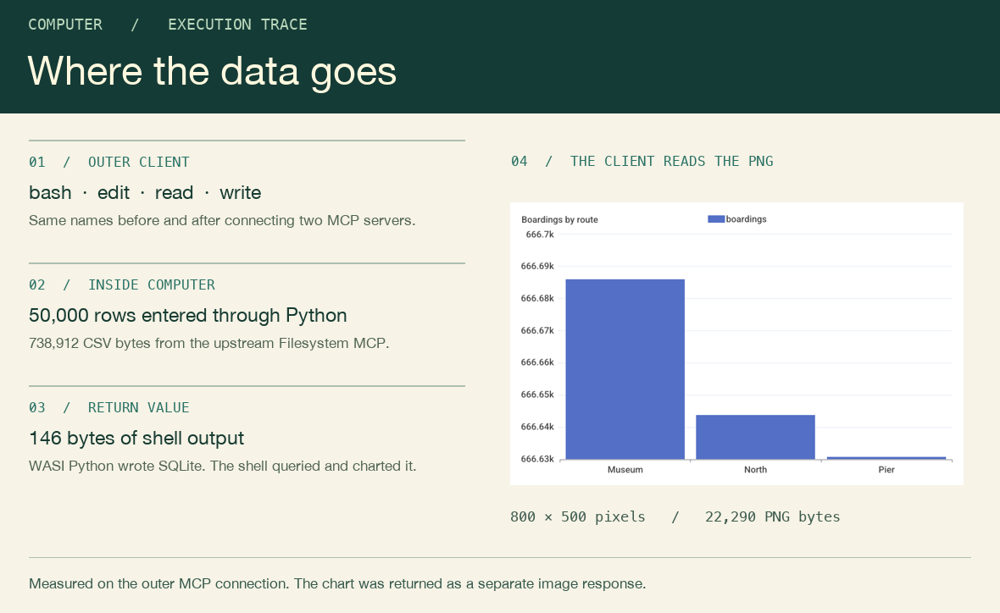
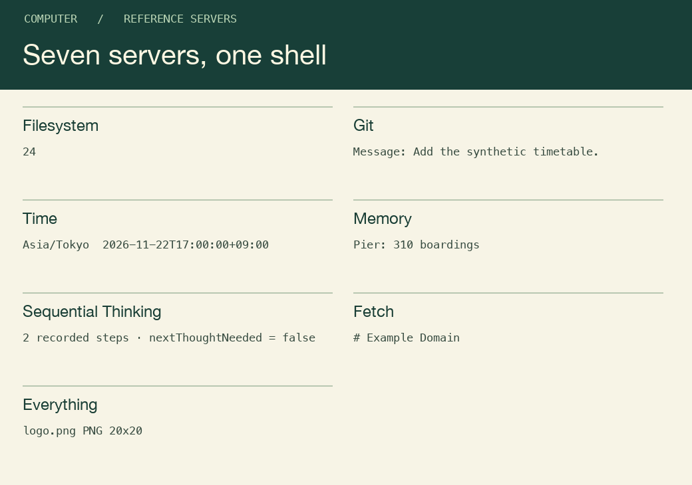
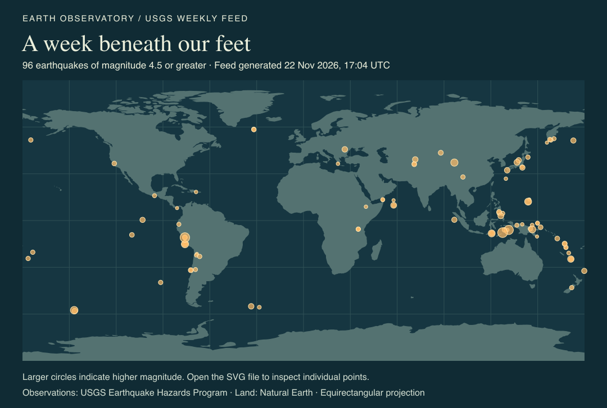
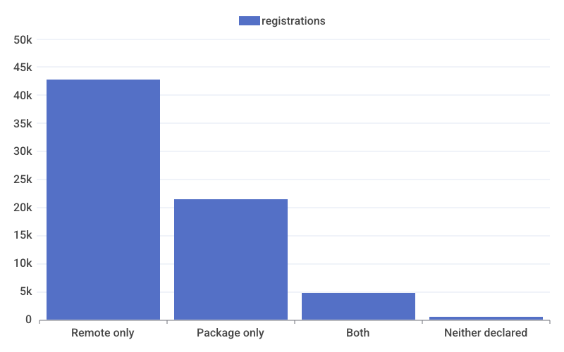
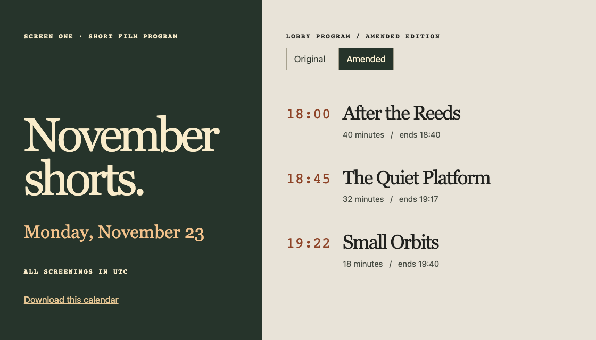
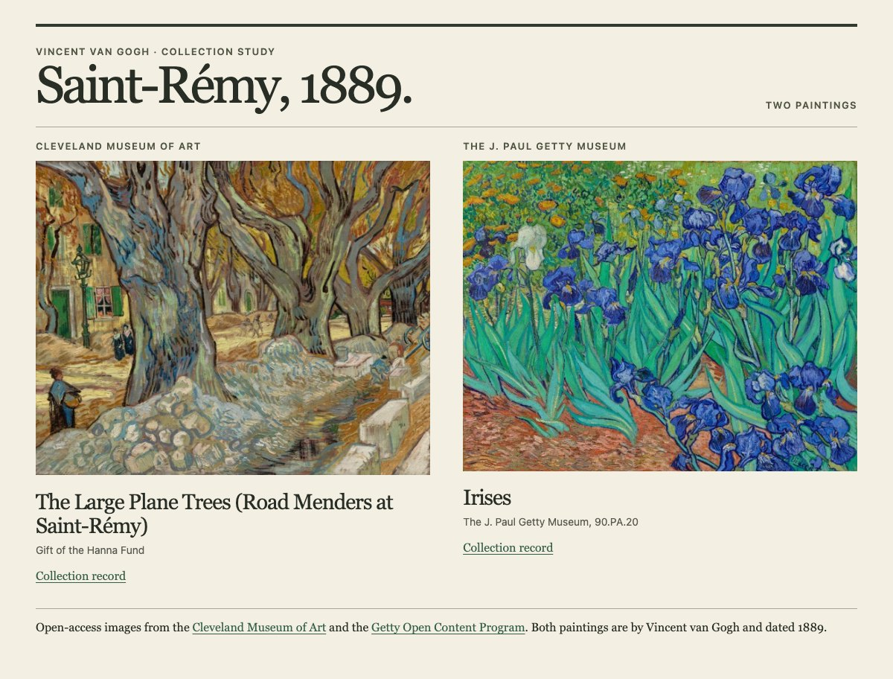
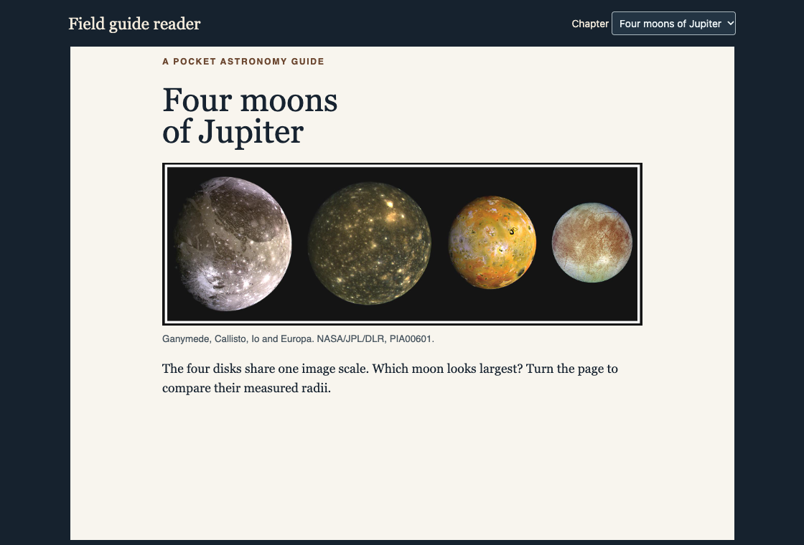

# Computer field guide

[Download the visual guide for offline use](offline-guide/README.md) · [Browse all 164 exhibits](offline-guide/catalog.md)

## What crosses the MCP connection?

A client lists four tools, runs a program beside a 50,000-row upstream timetable, then retrieves the chart. Follow the outer calls, the generated Python bindings and the shared filesystem in one measured run.

[Follow the execution and replay it](four-tools/README.md)

## From a tool response to a ferry report

Which route had the most boardings? A single shell script reads 24 departures through an MCP tool, totals the passengers in SQLite and draws a chart. The host runs the Filesystem MCP. Computer runs the shell, SQLite and the chart command. The only mounted host folder holds the output.

[Replay the ferry report](ferry/README.md)

## A dispatch packet from the same data

The agent's computer can also produce the files people use at their desks. Print the one-page ferry ledger or open a workbook with formulas and a departure chart.

[Open the dispatch packet and replay it](dispatch/README.md)

## Seven servers in one shell

Read a file, inspect a commit, convert a time, query a graph, record milestones, fetch a page and save a binary image response in one session.

[Run the seven reference servers](reference-servers/README.md)

## A week beneath our feet

Two public data sources become a map inside Computer. Download the SVG and hover over a point in a browser to read its location and magnitude.

[Open the atlas and draw a fresh one](earthquake-atlas/README.md)

## Pass a file between MCP clients

MCP Inspector writes a notice, mcporter edits it, and a Python client reads and checks it. Three separate Computer processes share one mounted folder.

[Replay the client handoff](client-handoff/README.md)

## What if two dispatchers edit the same timetable?

Three Computer instances start from one read-only timetable. Two make independent changes to the same path and run the same shell command over their own version.

[Run the Go embedding example](what-if-workspaces/README.md)

## How much of the data reaches Gemini?

A full-file prompt and a Computer-filtered prompt answered the same question about 1,440 trips. Compare the actual provider-reported input tokens and inspect the fixed-query experimental design.

[Inspect the measurements or replay the experiment](model-input/README.md)

## Repair the bakery sales board

Computer reads a mobile browser audit, repairs the page in a mounted directory and sends Chrome to the new URL. Both original findings clear on the second audit.

[Replay the edit and inspect both reports](bakery-repair/README.md)

## What changed between rehearsal and opening night?

Computer reads two tagged lighting plans as separate filesystems. The show still runs for 133 seconds, but four cues changed duration and two changed color.

[Inspect the cue sheet and replay the comparison](stage-lighting/README.md)

## Compare the Great Lakes from orbit

Four NASA Terra MODIS observations became an offline application inside Computer. Switch the dates and move the divider to inspect the same landscape.

[Download the viewer and replay the workflow](earth-observer/README.md)

## Count the official MCP registry

Computer paged through 70,222 registrations and charted how providers distribute their servers. Replay all 703 captured page counts offline or collect a bounded live sample.

## Publish a revised festival program

The box office uses TypeScript, the projectionist uses Java and a calendar subscriber uses Python. Their three independent Computer sessions publish the lobby board and verify the revised calendar. A browser downloads the new edition.

## Bring two museum collections into the same room

A native rclone filesystem combines the Getty and Cleveland collections inside Computer. The guest produces a portable two-painting study with credited images and collection links.

## Run the offline workbook

Pick from 34 standalone shell recipes. Build images and charts, read or write documents, query a million SQLite rows and turn a timetable into sound. Every run starts with a new writable directory.

## Issue a printable lost-property ticket

Computer issues a PDF and QR for a fictional library desk. A Rust MCP client reads the original and rotated image, then independently scans a rendering of the printable ticket.

## Take four moons into the classroom

A Wikidata MCP query, a JPL measurement table and a credited spacecraft image become an offline e-book. Open the actual EPUB, compare the moon sizes and follow the chapter navigation on a phone.

