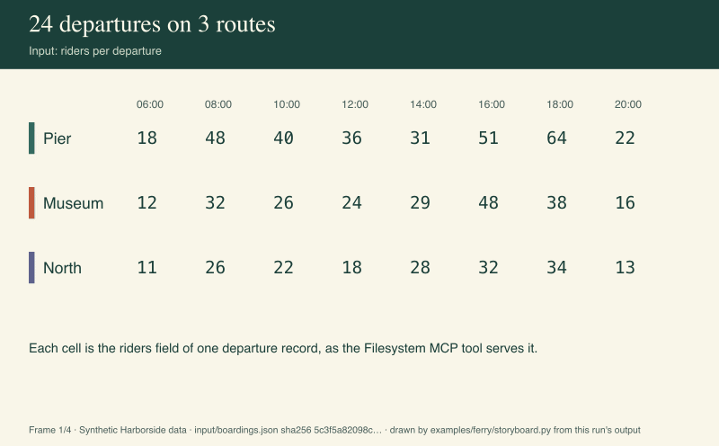
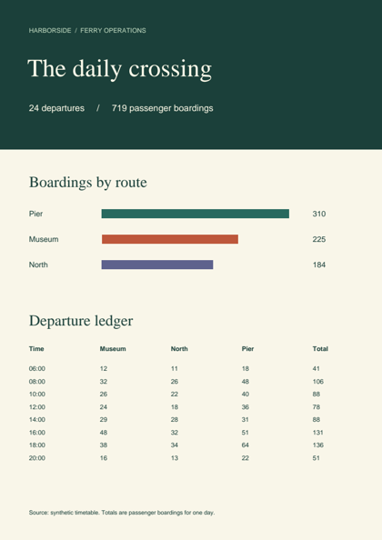

# Computer field guide

## From a tool response to a ferry report

Which route carried the most people? A single shell script reads 24 departures through an MCP tool, totals the passengers in SQLite and draws a chart. All three steps run inside Computer. The only mounted host folder holds the output.

[Replay the ferry report](ferry/README.md)

## A dispatch packet from the same data

The agent's computer can also produce the files people use at their desks. Print the one-page ferry ledger or open a workbook with formulas and a departure chart.

[Open the dispatch packet and replay it](dispatch/README.md)

## Seven servers in one shell

Read a file, inspect a commit, convert a time, query a graph, record milestones, fetch a page and save a binary image response in one session.

[Run the seven reference servers](reference-servers/README.md)
