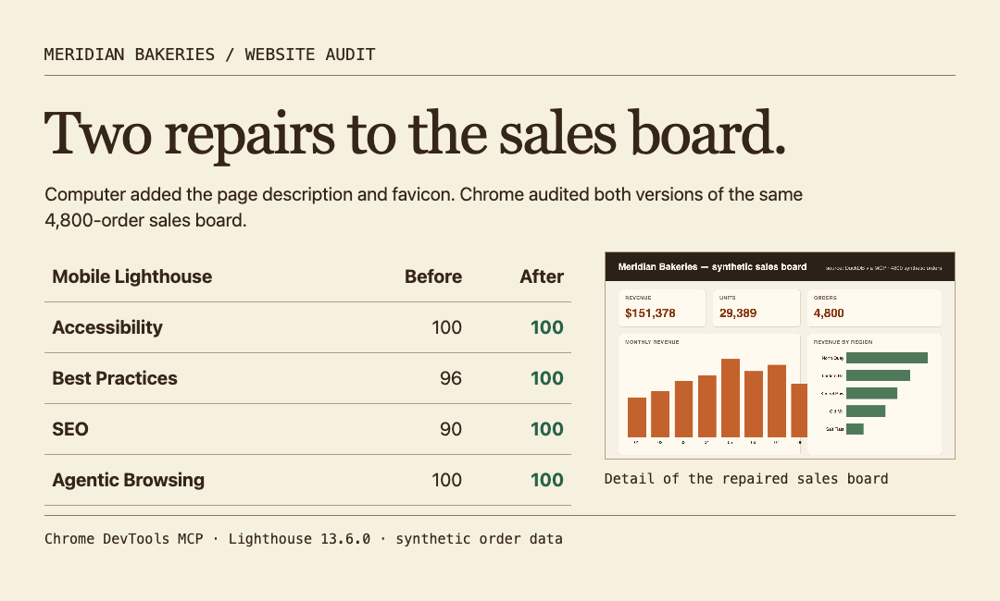

# Repair a bakery website and verify the change in Chrome



A bakery editor has a working sales board and two findings from a mobile Lighthouse audit. Computer opens the board through the Chrome DevTools MCP, reads the report, and writes a repaired page alongside the original. Chrome audits the new URL. Both versions still display 4,800 synthetic orders.

| Lighthouse 13.6.0 check | Original | Repaired |
| --- | ---: | ---: |
| Page has a meta description | Fail | Pass |
| Browser errors logged to the console | Fail | Pass |
| SEO category | 90 | 100 |
| Best Practices category | 96 | 100 |
| Accessibility category | 100 | 100 |

The original page had no description and requested a missing favicon. The repair adds a description and an inline empty favicon. The guest keeps the original HTML, reads both Lighthouse JSON reports, and assembles the comparison. The upstream MCP runs Chrome and takes its screenshots. The host starts a loopback HTTP server on an available port and checks that the original file still has its starting bytes. Chrome versions can change the category scores.

## Replay

Use a local Chrome installation, Node, Python 3, Go and Computer's WASI Python release. From the repository root, run the following commands with a new output directory. The first run of npm downloads the browser server. The audited site runs locally.

```sh
CGO_ENABLED=0 go build -o ./bin/computer ./cmd/computer
npm install --prefix ./bin/bakery-tools chrome-devtools-mcp@1.13.0
python3 examples/bakery-repair/replay.py --computer ./bin/computer \
  --python-wasi ./python-wasi --devtools ./bin/bakery-tools/node_modules/.bin/chrome-devtools-mcp \
  --output ./bin/bakery-audit
```

Supply `--chrome` with the Chrome executable path if Chrome is outside its standard install location. Open `bin/bakery-audit/site/audit.html` to see the comparison offline. Each of the two audit directories also contains the full Lighthouse report. To film the repair in another client, copy the two files from `site/` into that client's mounted folder. Serve the copy on loopback, ask the client to make the same edit, then open the new page in Chrome.

[WASI Python setup](../../README.md#python) · [Guest repair and checks](repair.py) · [Exact results and file hashes](sample/result.json) · [Original board](site/index.html)
