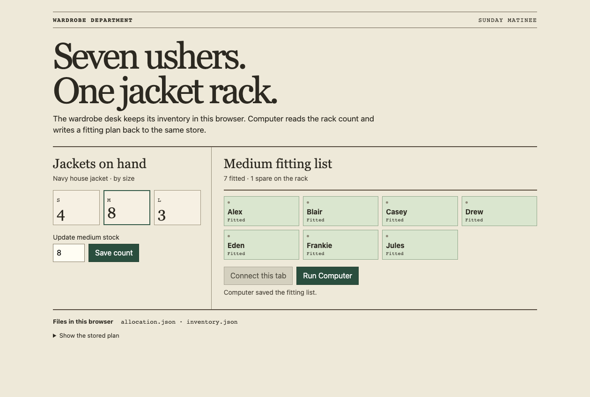

# Keep the wardrobe count in the browser

[Step through the recorded fitting](sample/wardrobe.html) or [watch the actual browser](sample/wardrobe.webm). An assistant counts jackets for seven ushers. The first count is five, leaving two without a jacket. The assistant finds three more and saves the correction offline. Computer reads the updated count and writes a new fitting list with one jacket to spare.



Chrome stores two real files, `inventory.json` and `allocation.json`, in its [origin-private file system](https://developer.mozilla.org/en-US/docs/Web/API/File_System_API/Origin_private_file_system). This example exposes two fixed MCP tools for the wardrobe. A local stdio bridge forwards their requests to the connected browser tab. Computer’s WASI Python imports the generated `tools.wardrobe` module, calculates the allocation and asks the browser to save it. The tab enables its connection button once its storage is ready. Before writing the plan, it checks the SHA-256 of the stock serialized with compact JSON. This is a tool-mediated browser store.

## Run the live desk

Use a recent Chrome, Node.js 22 or newer, Go, and the project’s WASI Python distribution. From the repository root run:

```sh
mkdir -p bin
go build -o bin/computer ./cmd/computer
go build -o bin/wardrobe-bridge ./examples/browser-wardrobe/bridge
node examples/browser-wardrobe/app/desk.mjs bin/computer bin/python-wasi-2 bin/wardrobe-bridge
```

Open the printed loopback URL in a disposable browser profile. Select **Connect this tab**, then **Run Computer**. Change medium stock to eight and save the count. Run Computer again and reload that same URL. Each fresh server chooses a new port, so its OPFS origin is distinct. Keep the server running to revisit the same store. Although the count can be saved offline, the tab needs its loopback connection to run Computer.

## What was verified

Both the 1260-pixel and 390-pixel runs began with new Chrome profiles. The recorder disabled browser networking and verified a local HTTP fetch failed while the OPFS write succeeded. It compared the stored records, restored the connection, ran Computer a second time, closed the entire browser and reopened its profile. Both files were byte-identical after that restart. The real desk and stdio bridge only use loopback traffic. The examples use synthetic staffing and inventory data.

The [browser receipts](sample/browser.json) contain all three inventory revisions, allocations and restart checks. The [phone capture](sample/phone.png) shows the result. Chrome and Playwright Core can replay the flow into a new output directory:

```sh
npm install --prefix bin/wardrobe-record playwright-core
NODE_PATH="$PWD/bin/wardrobe-record/node_modules" node examples/browser-wardrobe/record.cjs \
  "$PWD/bin/computer" "$PWD/bin/python-wasi-2" "$PWD/bin/wardrobe-bridge" "$PWD/bin/wardrobe-capture"
```
