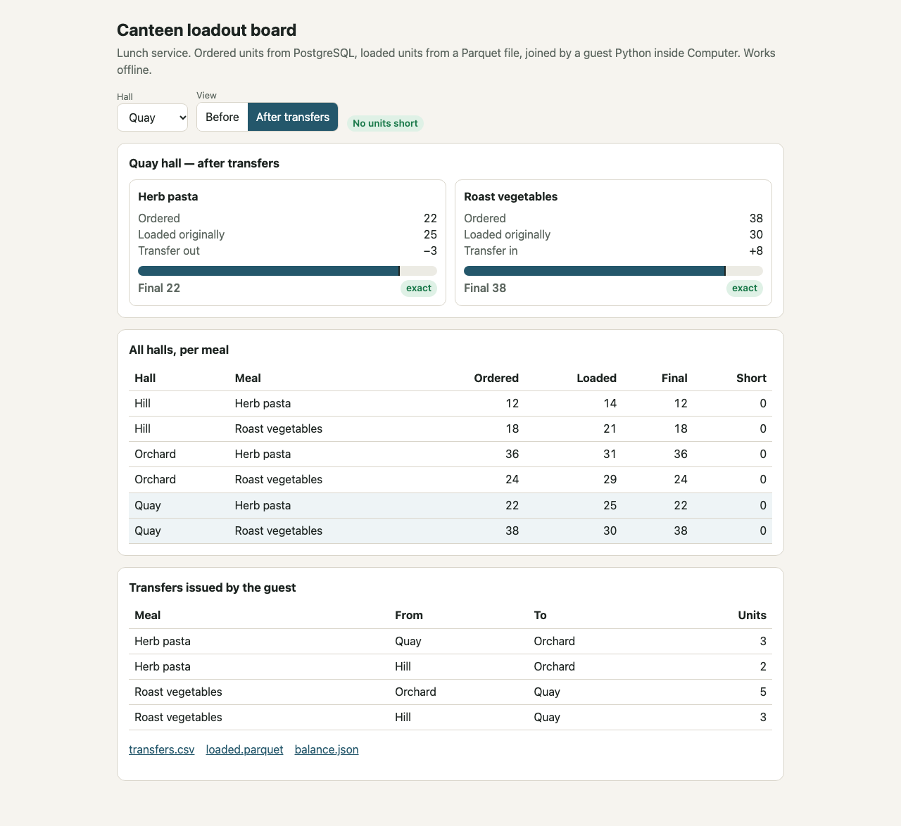

# Balance three lunch deliveries across PostgreSQL and Parquet

[Open the offline loading board](board/index.html) · [Watch the transfer list change](evidence/board-recording.mp4) · [Download the balanced transfers](board/data/transfers.csv)



Synthetic lunch data (6 rows each, 150 units). Computer's guest Python pulls **ordered** from PostgreSQL and **loaded** from a Parquet file, joins on hall/service/meal, and writes balanced transfers.

| Piece | What | Pin |
|---|---|---|
| PostgreSQL | disposable cluster, `listen_addresses=''`, UNIX socket in a temp dir, random port, OS user (no superuser role used by the MCP); MCP role `canteen_reader` has SELECT on one aggregate view only | 17.10 (Homebrew) |
| Postgres MCP | `@modelcontextprotocol/server-postgres` — **archived/unmaintained upstream** (disclosed; used genuinely, its `query` tool runs in a read-only transaction) | 0.6.2 |
| Parquet | written by DuckDB `COPY ... TO (FORMAT parquet, COMPRESSION zstd)`; `loads.duckdb` holds view `loaded_totals` over `read_parquet('<run>/loaded.parquet')` | DuckDB 1.5.6 |
| DuckDB MCP | `mcp-server-motherduck` run locally on the file, read-only, no token, no cloud | 1.1.1 |
| Computer | stock CLI, `-config` with both `mcpServers`; tools used as generated commands/modules `orders-pg query`, `loads-duck execute-query`, `from tools import orders_pg, loads_duck` | binary sha256 prefix `db7a0e30c5c99680` (`computer` built 2026-11-21) |
| Guest | WASI CPython | 3.15.2 |
| Independent check | `psql` + `pyarrow` (never DuckDB/MCP), `python -I` | pyarrow 26.0.1 |

## Result
Original shortages: Quay roast vegetables 8, Orchard herb pasta 5 (13 units; each meal already has its full citywide quantity).
Transfers (`transfers.csv`, written by the guest): roast vegetables Orchard→Quay 5, Hill→Quay 3; herb pasta Quay→Orchard 3, Hill→Orchard 2.
Final per hall (ordered = final): Hill 12 pasta / 18 roast; Orchard 36 / 24; Quay 22 / 38. Units short after: 0.

## Replay
```
sh replay/install.sh SUPPORT
python3 replay/run.py --support SUPPORT --pywasi PATH_TO_PYTHON_WASI --out runs/new   # needs `computer` on PATH
python3 replay/build_board.py runs/new/balance.json board
```
Each run creates a fresh temp store, starts and stops its own Postgres, and deletes it. `runs/run1`, `runs/run2` are two such fresh runs (both PASS; `transfers.csv` and `loaded.parquet` byte-identical). `receipt.json` has every command output with paths replaced by `<RUN>`/`<SUPPORT>`; `independent-verify.json` has psql/pyarrow results and the six checks.

`board/index.html` is the offline operator board (no network requests, verified in browser capture; open directly). Downloads in `board/data/`: `loaded.parquet` (native Parquet), `transfers.csv`, `balance.json`. `evidence/`: desktop and mobile before/after PNGs and a 10 s screen recording of the board (headless Chromium via Playwright).

## Boundaries
- Computer's `-python` WASI build is not bundled; pass your own.
- Postgres MCP is the archived one; no maintained alternative was tried (time-boxed, per brief).
- The DuckDB view stores an absolute Parquet path, so the DuckDB file is only valid in the run that made it.
- Run 1 was preceded by fixes to my verify/run scripts (no data/logic change); both captured runs used the same reconciliation logic.
