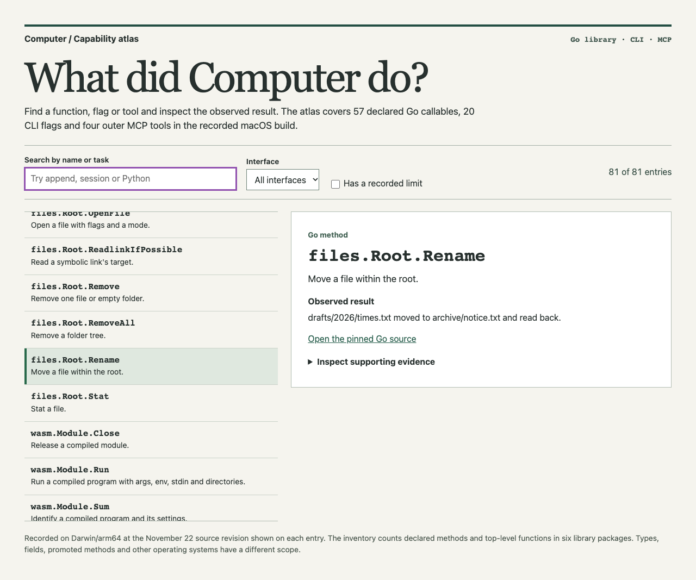

# Find an observed Computer capability

[Open the offline atlas](sample/atlas.html) · [Watch the search and filters](sample/atlas.webm) · [Download the machine-readable observations](sample/atlas.json)



Search by a job such as “append,” a flag such as `-python-runs`, or a symbol such as `computer.Computer.Session`. Each selection explains what ran, what came back and where the declaration lives. Forty entries carry an additional note narrowing the measurement. The reader works offline. Its source links open the pinned repository.

| Interface in the observed build | Entries | An example of the evidence |
| --- | ---: | --- |
| Exported Go functions | 15 | A library-hours server returned Sunday 16:00 through an official Go MCP client, generated host binding and registered shell command. |
| Methods declared on exported Go types | 42 | A rooted filesystem moved an evening notice between two directories and reopened its contents. |
| CLI flags | 20 | The same public URL request returned exit 127 with the base command set. With its exact allowed prefix, curl returned the 577-byte Example Domain page. |
| Outer MCP tools | 4 | A client listed `bash`, `edit`, `read` and `write` before and after adding upstream servers. Separate clients exercised the file operations. |

The Go inventory uses the build-selected source in the six library packages at the [recorded revision](https://github.com/Lakeshore-Labs/computer/tree/ea7bf2356c679b2b2ebddf0498be4616da22ec83). It excludes interfaces, fields, type declarations, promoted methods, nested example modules and other platforms’ files. A recorded call can be narrow. For example, `files.Root.Chown` was called with both IDs set to -1, keeping the existing ownership. The scope notes identify such cases.

## Reproduce the probes

Run these commands from the repository root on a Unix system. The probes use temporary folders and a local in-memory MCP server.

```sh
go run ./examples/capability-atlas/inventory .
go run ./examples/capability-atlas/files
go run ./examples/capability-atlas/tools
go run ./examples/capability-atlas/environment
python3 examples/capability-atlas/build.py
```

The inventory lists declarations for your current checkout. The other commands print observations. Compare with the [pinned declaration list](sample/declarations.json), [filesystem receipt](sample/files.json), [three library lookups](sample/tools.json), [environment and module checks](sample/environment.json), [CLI comparisons](sample/cli.json) and [paired public fetch](sample/allowed-fetch.json). The existing upstream suite and individual examples supply the other observations. Rebuilding the standalone page checks the declaration list and all receipt references.

Desktop and 390-pixel phone runs checked the four category counts, search, a zero-result query, the scope filter, a selected source link and its supporting evidence. [Browser results](sample/browser.json)
