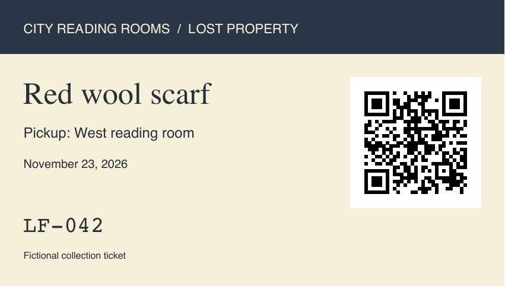

# Issue and scan a lost-property ticket

A library desk needs a printable claim for a red wool scarf. An official Rust MCP client starts Computer over stdio. Computer runs a Python wheel in WASI, writes a QR image and a vector PDF into the writable workspace, and rotates the image with its built-in magick command. Scan any of the three outputs to recover `urn:example:lost-property:LF-042`.

[](sample/claim.pdf)

| Artifact | What checked it |
| --- | --- |
| [Original QR image](sample/claim.png) | Rust read the PNG through Computer’s MCP read tool, compared the returned bytes with the mounted file, and decoded the payload with Quirc. |
| [Quarter-turn image](sample/rotated.png) | The same client decoded the rotated PNG from a second MCP read. This path runs on the stock CLI. |
| [Printable PDF](sample/claim.pdf) | Poppler rendered the vector page at 144 DPI. Quirc decoded the resulting page image. |

An additional run used the proposed fractional-angle feature. Its 9° image decoded to the same reference. [Tilted QR](sample/off-axis/rotated.png) · [Off-axis checks](sample/off-axis/checks.json) · [Computer image rotation PR](https://github.com/Lakeshore-Labs/computer/pull/35)

## Replay

Use a Computer build with the project’s WASI Python release, a Rust toolchain, Python 3.10+ on the host and Poppler’s `pdftoppm`. The first build downloads locked Rust crates. The host downloads and verifies the pinned pure-Python Segno wheel and mounts it read-only. The guest receives no network capability.

```sh
python3 examples/claim-ticket/replay.py \
  --computer ./bin/computer \
  --python-dir ./bin/python-wasi-2 \
  --output ./bin/claim-desk
```

The output directory must be new. Open `claim.pdf` to print the 150 × 85 mm ticket. The reference, item and desk are synthetic. To run offline, prefetch the locked Cargo dependencies, set `CARGO_NET_OFFLINE=true`, and pass `--wheel /path/to/segno-1.6.6-py3-none-any.whl`. Set `CARGO_TARGET_DIR` to reuse an existing Rust build. The default is a temporary build directory. The optional `--degrees 9` replay requires the image-rotation PR.

[Recorded stock checks and artifact hashes](sample/checks.json) · [Source fixture](recipe/lost-property.json) · [Guest publisher](recipe/issue.py) · [Rust client](client/src/main.rs) · [Wheel source and SHA-256](source.json)
