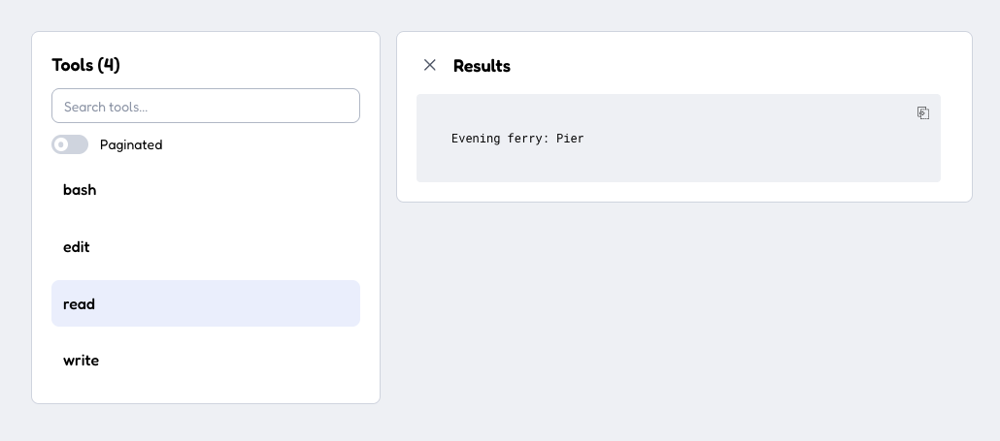

# Pass a file between MCP clients



An operator writes a departure notice in MCP Inspector. Another client edits it. A third reads the result and runs a checksum inside Computer. Each client starts a fresh Computer MCP process with the same directory mounted at `/work`. The mount carries the file between those processes.

| Client | Computer tool | Result |
| --- | --- | --- |
| MCP Inspector CLI | `write` | Writes `Morning ferry: Pier` to `handoff.txt`. |
| mcporter | `edit` | Replaces the exact text `Morning` with `Evening`. |
| Python MCP SDK | `read`, then `bash` | Reads `Evening ferry: Pier` and verifies the shell checksum against the expected bytes. |

The image is a cropped screenshot from the real Inspector web interface reading the completed file. The final check also reads the mounted file directly from the host.

## Replay

From the repository root, use Go, npm and uv. Choose a fresh output directory. The first run downloads the top-level client package versions specified in the script. No model or service account is needed.

```sh
go build -o ./bin/computer ./cmd/computer
uv run --with mcp==2.3.0 python examples/client-handoff/replay.py \
  --computer ./bin/computer --output ./bin/client-handoff
```

[Read the client calls](replay.py)
