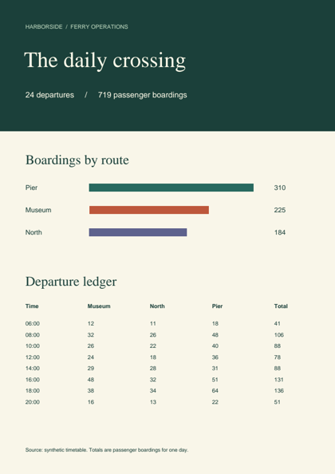

# Print the daily crossing



The same 24 ferry departures become two documents. A dispatcher gets a one-page PDF with route totals and a ledger. An analyst gets an Excel workbook with formulas and a line chart. Both read the same JSON input. The program reopens the workbook and checks its cached formula results against the source total.

[Open the PDF](media/dispatch.pdf) · [Download the workbook](media/dispatch.xlsx) · [Read the program](packet.py)

## Replay

Build the Computer binary as described in the main README. Download and unpack the project's Python WASI release as described in [the Python build notes](../../python/README.md). From the repository root, run the command below with the path to that unpacked directory.

```sh
sh examples/dispatch/run.sh ./bin/computer ./python-wasi ./bin/dispatch
```

Computer runs CPython to write the PDF and XLSX, reads them back, renders the PDF with PDFium, and resizes its first page for the preview. The output directory contains both documents, the full-page PNG, and its thumbnail. The program uses the libraries shipped in the Python WASI release.
