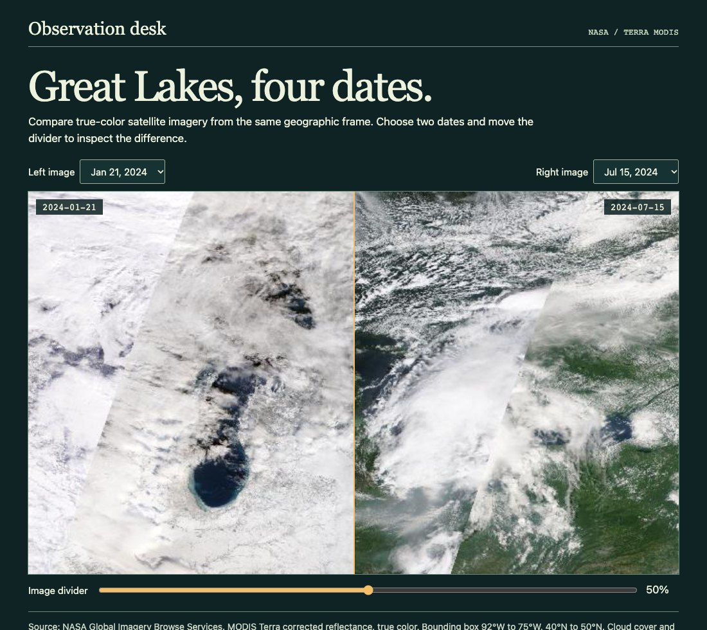

# Compare four satellite views of the Great Lakes

[](sample/desk.mp4)

[Download the interactive desk](sample/desk.html?raw=true) · [Watch the recorded comparison](sample/desk.mp4) · [Inspect the four source images and receipts](scenes/)

Open the downloaded HTML in a browser, choose a different date on each side and move the divider. The four true-color scenes cover the same geographic frame, from 92°W to 75°W and 40°N to 50°N. Both cloud cover and changes on the surface affect what you see.

Computer fetched the four JPEGs from a single allowed NASA GIBS WMS endpoint. Each image is 680 × 400 pixels. The guest shell inspected the files, and WASI Python calculated the digests and embedded all 268,584 source bytes in a standalone viewer. The host independently decoded all four embedded images and compared their bytes to their source files.

## Rebuild from the capture

Use the project's WASI Python release and a new output directory. The recorded replay uses two read-only input mounts and a writable output mount. It runs without any network permissions.

```sh
CGO_ENABLED=0 go build -o ./bin/computer ./cmd/computer
python3 examples/earth-observer/replay.py --computer ./bin/computer \
  --python-wasi ./python-wasi --output ./bin/great-lakes
```

Open `bin/great-lakes/desk.html`. Add `--live` and choose a different output directory to request those same four dates from NASA. Live runs record the bytes actually returned.

## Verify the viewer in Chrome

The browser check disconnects the page from the network, switches both dates, moves the divider with the keyboard, checks the layout at 390 pixels wide and records 42 actual browser states. FFmpeg encodes those states into the supplied film. To repeat the visual checks, use Chrome and FFmpeg alongside Node.

```sh
npm install --prefix ./bin/earth-browser playwright-core@1.66.0-alpha-2026-11-18
NODE_PATH="$PWD/bin/earth-browser/node_modules" node examples/earth-observer/record.cjs \
  ./bin/great-lakes/desk.html ./bin/great-lakes-film
```

Imagery is from NASA Global Imagery Browse Services, MODIS Terra Corrected Reflectance (True Color), observed January 21, April 6, July 15 and October 5, 2024. [NASA GIBS service documentation](https://nasa-gibs.github.io/gibs-api-docs/access-basics/) · [WASI Python setup](../../README.md#python) · [Guest assembler](assemble.py) · [Recorded browser checks](sample/browser.json)
