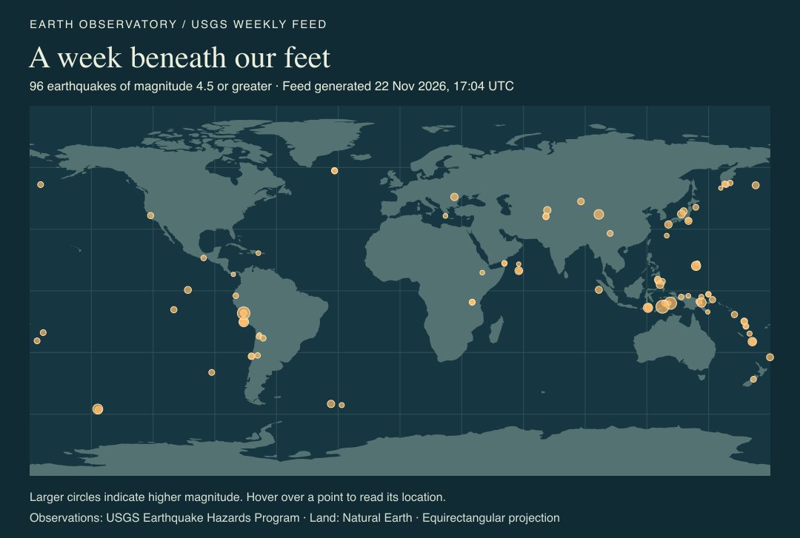

# A week beneath our feet

[](media/atlas.svg)

Open the SVG and hover over a point for the magnitude and location. This capture contains 96 earthquakes from the USGS magnitude 4.5+ past-week feed generated at 17:04 UTC on November 22, 2026. The live recipe will show the week at the time you run it.

## Replay with live observations

From the repository root, use a built Computer binary and its [WASI Python distribution](../../python/README.md).

```sh
sh examples/earthquake-atlas/run.sh ./bin/computer ./python-wasi ./bin/earthquake-atlas
```

The shell has two allowed URLs. It downloads the feed and the pinned Natural Earth land geometry into the output mount. Python projects longitude and latitude onto a world map and writes an SVG with a title for every observation. The output directory holds both source responses and the map.

## Replay the captured week

After the live run has downloaded the pinned land geometry, put the saved observation file in place and run the renderer again. This reproduces the committed SVG.

```sh
cp examples/earthquake-atlas/media/snapshot.geojson ./bin/earthquake-atlas/earthquakes.json
./bin/computer -mount ./bin/earthquake-atlas:/work -mount ./examples/earthquake-atlas:/recipe:ro \
  -python ./python-wasi/python.wasm -python-lib ./python-wasi/lib -c 'python3 /recipe/map.py'
```

[Map renderer](map.py) · [USGS GeoJSON feed documentation](https://earthquake.usgs.gov/earthquakes/feed/v1.0/geojson.php) · [Natural Earth land data and reuse terms](https://www.naturalearthdata.com/about/terms-of-use/)
