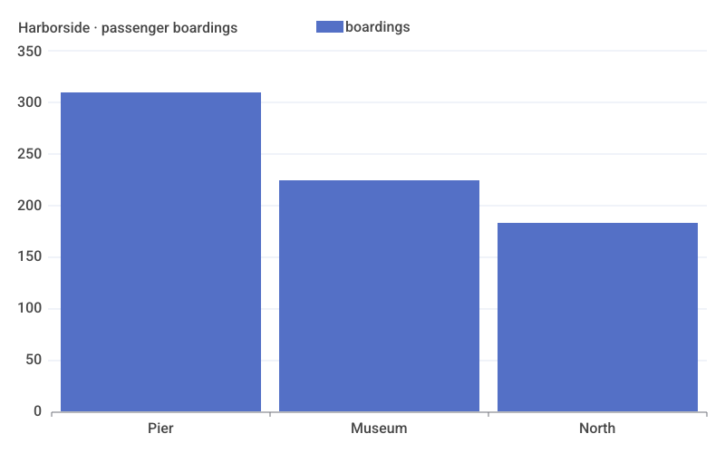

# Which ferry route had the most boardings?

The fictional Harborside timetable contains 24 departures across three routes. Pier recorded 310 boardings, Museum 225 and North 184. The script reads the JSON through the official Filesystem MCP, sums the records with SQLite and writes the chart to a mounted directory.



## Replay

From the repository root, use Go to build Computer. Python 3 launches the demo. Node and npm run the upstream reference server on the host. The first run downloads the specified server version and resolves its dependencies from npm. Choose a fresh output directory.

```sh
CGO_ENABLED=0 go build -o ./bin/computer ./cmd/computer
python3 examples/ferry/run.py --computer ./bin/computer --output ./bin/ferry-report
```

The host independently totals the input records and checks the CSV written by Computer. The program prints the three totals and the dimensions of the generated chart. Open `./bin/ferry-report/ferry.png`. The adjacent `totals.csv` contains the data behind it. To use an existing installation of version 2.4.0, append `--server /path/to/mcp-server-filesystem`.

## Follow the data

1. The host starts the reference server with the input directory marked read-only. Computer mounts the output directory at `/work`.
2. The generated `files read-text-file` command returns a JSON object. The shell selects its `content` field, which holds the 24 records.
3. SQLite's `json_each` expands the records into rows. The group-by query writes one total per route into a CSV file.
4. The `chart` command reads the CSV, and `identify` reports the PNG format and dimensions.

The four-frame animation uses the actual timetable, totals and generated PNG. To regenerate it on the host, install ffmpeg and librsvg, then run the command below after the report finishes.

```sh
python3 examples/ferry/storyboard.py --report ./bin/ferry-report --output ./bin/ferry-story.gif
```

[Read the shell script](report.sh) · [Inspect the synthetic input](input/boardings.json) · [Watch the illustrated run](media/ferry-story.gif)
