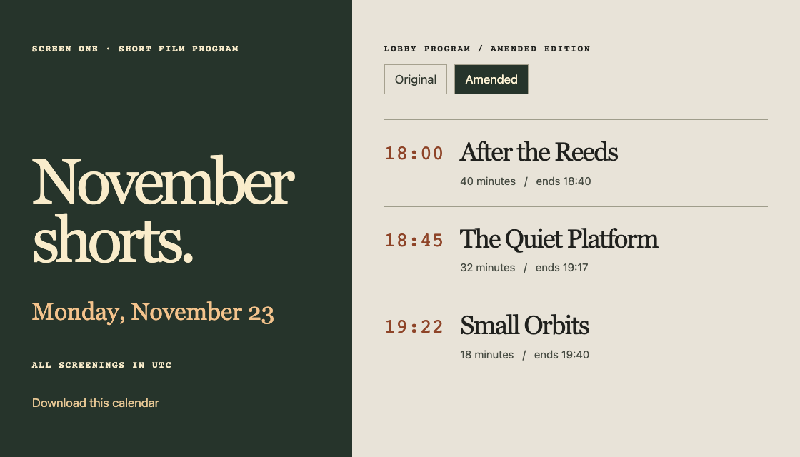

# Change a festival running time across three MCP clients

[](sample/amended.ics)

The first film was booked for 25 minutes. The projectionist receives a 40-minute cut. The screenings that follow move from 18:30 to 18:45 and from 19:07 to 19:22 UTC. Both editions are included so a reader can compare them.

| Who uses Computer | What they do | What to inspect |
| --- | --- | --- |
| Box office, using the TypeScript SDK from Node | Writes the three-film fixture, then runs WASI Python inside Computer to publish the original lobby page and calendar | [Original program](sample/original.png) and [calendar](sample/original.ics) |
| Projectionist, using the Java SDK | Starts another Computer process, edits one running time and regenerates both publications | [Amended program](sample/amended.png) and [calendar](sample/amended.ics) |
| Calendar subscriber, using the Python SDK | Starts a third Computer with a read-only mount, reads both calendars and parses the returned bytes with icalendar | [Screening times, stable event IDs, revision numbers and hashes](sample/subscriber.json) |

The programs and calendars share a mounted directory. Each client establishes its own stdio session. The guest recalculates the schedule with five minutes between films. Event IDs stay stable when the edition changes. The fixture includes the publication times for both editions.

## Replay the three clients

Use JDK 21 or later, Maven, Node, uv and the project’s WASI Python release. The initial dependency installations need network access.

```sh
CGO_ENABLED=0 go build -o ./bin/computer ./cmd/computer
npm install --prefix ./bin/festival-node @modelcontextprotocol/sdk@1.32.2
export NODE_PATH="$PWD/bin/festival-node/node_modules"
uv run --with mcp==2.3.0 --with icalendar==7.3.2 python examples/festival-calendar/replay.py \
  --computer ./bin/computer --python-wasi ./python-wasi --output ./bin/festival
```

Open `bin/festival/original.html`, select **Amended**, then choose **Download this calendar**. Both HTML files and both ICS files belong in the same directory. UTC is printed on each program. Nothing in this replay adds events to a personal calendar.

## Replay the browser check

With Chrome installed, run the following in the same shell. The browser runs offline, changes the edition, checks all three times, downloads the revised calendar, verifies its bytes and switches back at a 390-pixel viewport.

```sh
npm install --prefix ./bin/festival-node playwright-core@1.66.0-alpha-2026-11-18
node examples/festival-calendar/record.cjs ./bin/festival ./bin/festival-film
```

[Original client receipt](sample/boxoffice.json) · [Java edit receipt](sample/projectionist.json) · [Browser check](sample/browser.json) · [Phone capture](sample/phone.png) · [Python runtime setup](../../README.md#python)
