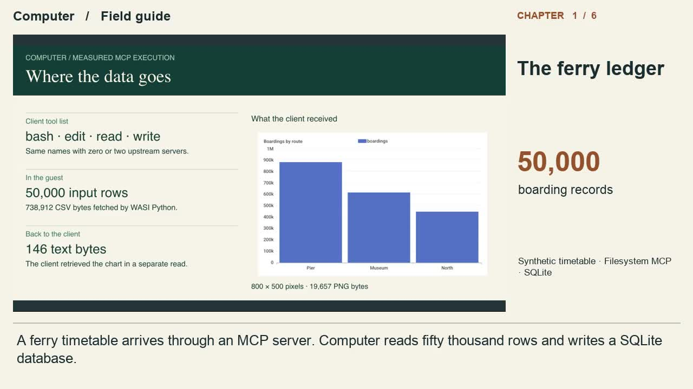

# Six short visits to Computer

[Download the narrated film](sample/computer.mp4?raw=true) · [Read the transcript](sample/transcript.md) · [Get the captions](sample/captions.vtt)

[](sample/computer.mp4?raw=true)

The 79-second film uses original captures from six runnable examples. Download the sample directory and open [the chapter player](sample/index.html) to watch or jump between chapters offline. The MP4 carries six named chapters, English narration, open captions, a selectable English subtitle track and the synthesized opening of the original rehearsal score. [Embedded chapter times](sample/native-chapters.json)

| Chapter | Open the original exhibit |
| --- | --- |
| Ferry boardings | [Read 50,000 rows through Filesystem MCP, query SQLite and retrieve the chart](../four-tools/) |
| Venice satellite windows | [Decode three Sentinel-2 windows from four byte ranges](../lagoon-windows/) |
| A designer’s palette | [Use the Swift MCP client and export native colors](../lagoon-palette/) |
| Oslofjord in relief | [Rotate the models or inspect the independently sliced layers](../terrain-workshop/) |
| Sunday’s fitting | [Save inventory offline and let Computer plan the fitting](../browser-wardrobe/) |
| Last Boat Home | [Play the score, read the written pitches and download both parts](../rehearsal-room/) |

The [edit list](scenes.json) identifies the shots and captions. The [recorded chapters](sample/chapters.json) give each original capture’s SHA-256 digest and its position in the film. Short recordings hold on their last frame. The examples distinguish work done in Computer from work done by a client or independent reader. The wardrobe, timetable and music use original demonstration material. Venice contains modified Copernicus Sentinel data (2024). The terrain and music examples include their source credits and verification.

## Render a fresh copy

Install FFmpeg and a Python environment with Pillow and piper-tts. Download the en_US-ljspeech-high voice and its adjacent ONNX JSON configuration. The renderer verifies both model files. Supply two local TrueType fonts and run these commands from the repository root. The original used Arial and Arial Bold.

```sh
python examples/field-film/render.py --voice voice.onnx --font regular.ttf --bold bold.ttf --out film
python examples/field-film/player.py film
```

Piper supplies synthetic narration using the LJ Speech High model. Voice timings can vary between renders. The source score supplies the synthesized flute phrase. [Piper voice model card](https://huggingface.co/rhasspy/piper-voices/blob/main/en/en_US/ljspeech/high/MODEL_CARD)
