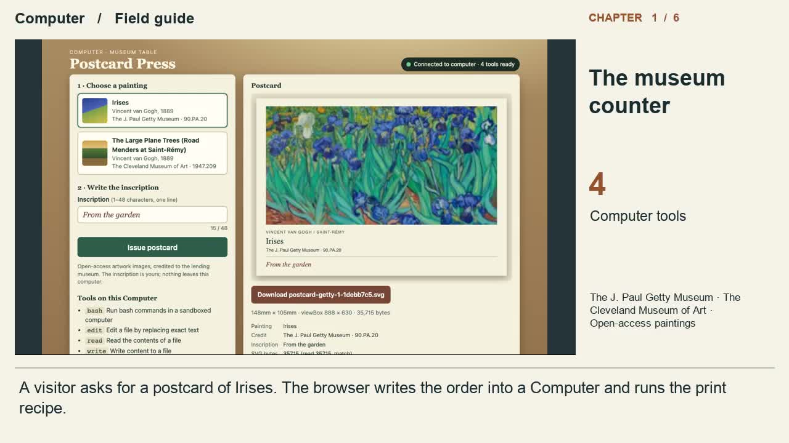

# Where the files go

[](sample/computer.mp4?raw=true)

[Watch the 82-second film](sample/computer.mp4?raw=true) · [Open the offline chapter player](sample/index.html) · [Read the transcript](sample/transcript.md)

A visitor changes a museum postcard. A printer accepts the amended proof. A learner updates a deck after studying. A radio producer recovers a cue after a server restart. Three kitchens balance their deliveries, and a book club moves its meeting while reusing the original book.

All twelve shots come from the six runnable exhibits. The guest and its receiving applications have different roles throughout. The narration is synthesized. The radio chapter includes the recovered station cue, mixed after the narration. The printer is a local emulator, and the gallery visitors, meals and book-club orders are synthetic. The original paintings are open-access images credited to The J. Paul Getty Museum and The Cleveland Museum of Art. [Postcards](../../postcard-press/) · [Print job](../../museum-print-run/) · [Study deck](../../moon-cards/) · [Radio cue](../../radio-jetstream/) · [Lunch round](../../canteen-loadout/) · [Island book club](../../island-mailbag/)

The [edit list](scenes.json), [source digests and frame timings](sample/chapters.json), [stream and source checks](sample/media-check.json) and [desktop and phone playback checks](sample/browser.json) accompany the film. Both browser sizes played all six native chapter positions and reopened the standalone MP4.

Use the same dependencies, pinned Piper voice and fonts as the [first film](../README.md). From the repository root:

```sh
python examples/field-film/render.py --scenes examples/field-film/working-files/scenes.json \
  --title 'Where the files go' --voice voice.onnx --font regular.ttf --bold bold.ttf --out working-files
python examples/field-film/player.py working-files --title 'Where the files go' \
  --intro 'Follow six Computer outputs into the hands of a museum visitor, print operator, learner, radio producer, kitchen dispatcher and book club.'
```
