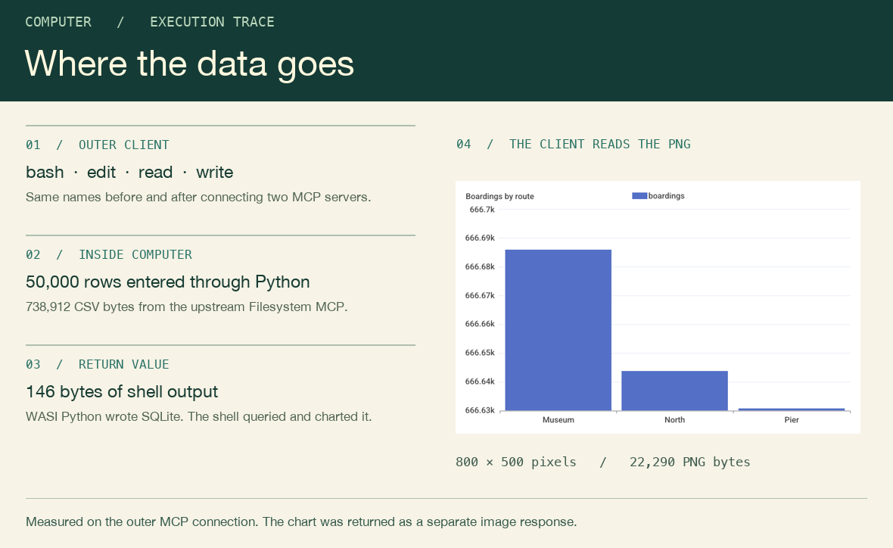

# Follow one call through Computer

[](sample/trace.json)

An MCP client needs a chart of passenger boardings. The timetable lives behind a read-only Filesystem MCP server. Computer has a writable output mount and a second upstream server that supplies a small PNG. Here is what each participant did during the recorded run.

| Step | Where it runs | Recorded result |
| --- | --- | --- |
| List the tools, then attach both upstream servers and list again | Python SDK talking to two fresh Computer MCP processes | Both lists contain exactly `bash`, `edit`, `read`, and `write`. |
| Call `bash` once | Computer's WASI Python imports the generated `tools` package | Python reads the upstream-only CSV, parses 738,912 bytes across 50,000 rows, and copies the second server's 20 × 20 image from its guest file path. |
| Compute the report in that same call | Python and the shell share Computer's filesystem | Python writes SQLite. The shell queries it, saves three route totals as CSV and draws a bar chart. |
| Return the shell result | Computer's outer `bash` tool | 146 UTF-8 bytes of text, including the totals and image dimensions. |
| Fetch the picture | The client's separate `read` call | The image block contains a 22,290-byte PNG. Its bytes match the chart on the output mount. |

The replay calculates expected totals from the fixture independently, compares both tool lists, and checks both images. The 146-byte measurement covers the text blocks in the shell response. The command, schemas, protocol envelopes and separate image response are outside that measurement. No model or provider account is needed.

[Read the recorded calls](sample/trace.json) · [Open the chart](sample/report.png) · [Inspect the totals](sample/totals.csv) · [Read the script that ran inside Computer](compute.sh)

## Replay

From the repository root, build the CLI and unpack the project's WASI Python distribution. Install the two pinned upstream servers and launch the outer client with the pinned Python MCP SDK. Choose a fresh output directory.

```sh
go build -o ./bin/computer ./cmd/computer
npm install --prefix ./bin/trace-servers @modelcontextprotocol/server-filesystem@2.4.0 @modelcontextprotocol/server-everything@2.3.1
uv run --with mcp==2.3.0 python examples/four-tools/replay.py \
  --computer ./bin/computer --python-wasi ./python-wasi \
  --server-bin ./bin/trace-servers/node_modules/.bin --output ./bin/trace-report
```

The host creates the synthetic timetable in a temporary folder available only to the upstream file server. After the checks it copies the finished chart, totals and trace into the output directory. The diagram above is a host-rendered illustration of the trace and includes the actual returned chart.

[WASI Python setup](../../python/README.md)
