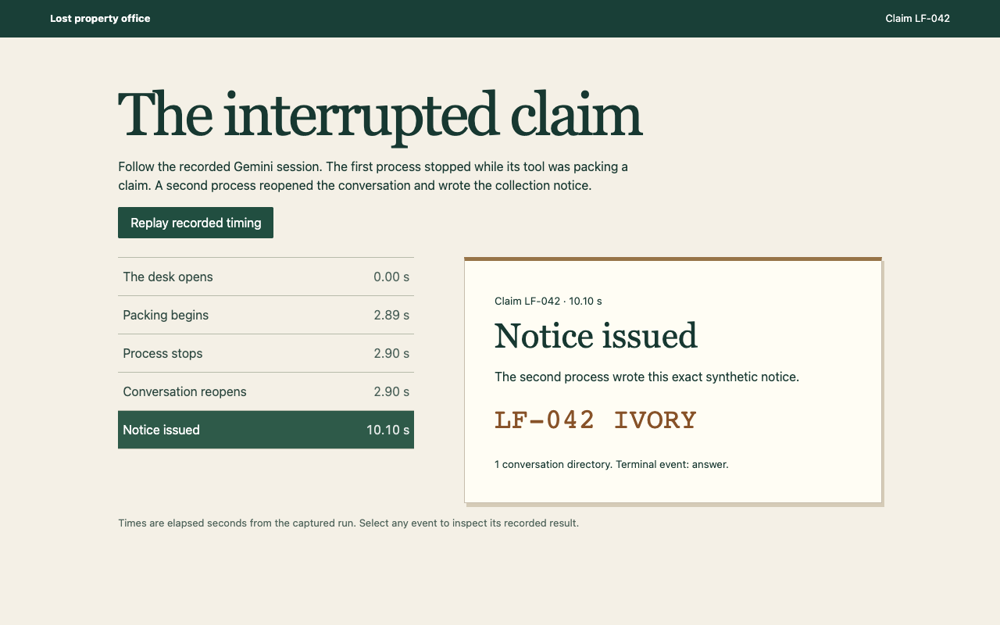

# Resume an interrupted Gemini tool call

The lost-property desk has a claim reference saved on disk and a pickup word supplied only in the conversation. Watch what happens when its standalone Computer process stops in the middle of packing the claim. [Open the recorded desk](sample/claim.html) · [Watch the recorded timing](sample/recovery.webm) · [Read the five observed events](sample/checks.json)

[](sample/claim.html)

## What happened

1. A fresh Computer process used its bundled QuickJS-WASI agent to call the direct Google Gemini endpoint. The agent called the guest shell to run the mounted packing script.
2. At 2.89 seconds the script had written LF-042 into its in-progress file and was waiting. The host observed one stored provider replay marker. The packed file was absent.
3. The controller stopped that child process. It exited with signal 9 before emitting a terminal agent event.
4. After stopping the first process, the controller wrote `desk-open.txt` to let the packing script skip its staged 30-second wait. A fresh Computer process received `agent -c` and an explicit request to check the files and rerun the idempotent script if needed. It reopened the conversation state and completed the job.
5. At 10.10 seconds the second process had written **LF-042 IVORY** and emitted an answer event. The host found one conversation directory. The follow-up prompt did not supply the word IVORY.

This demonstrates recovery of this particular repeatable operation with the standalone Gemini adapter. Applications with irreversible side effects need their own recovery semantics. The interactive desk is a replay of the recorded events, and the included film shows that replay. [Packing command](recipe/pack.sh) · [Desktop and phone checks](sample/browser.json)

## Try the recorded desk

Download [claim.html](sample/claim.html) and open it in a browser. The events, controls and timing are embedded. To regenerate it from the receipt using the stock Computer shell, use a new writable output directory.

```sh
mkdir -p ./bin/claim-view
./computer -mount "$PWD/bin/claim-view:/work" \
  -mount "$PWD/examples/gemini-recovery/sample:/capture:ro" \
  -mount "$PWD/examples/gemini-recovery/recipe:/recipe:ro" \
  -c 'bash /recipe/publish.sh'
```

## Repeat the live call

Use a POSIX host and build the Computer CLI and agent bundle from [the standalone adapter in #43](https://github.com/Lakeshore-Labs/computer/pull/43). Its [setup instructions](https://github.com/Lakeshore-Labs/computer/blob/47fecc9454ad1380a9ffa78014e6414a90d0c832/README.md) describe the matching QuickJS-WASI engine. Run the command below from this gallery checkout with paths to those builds. A live run calls Google and needs a model available to your key.

```sh
ADAPTER=/path/to/built-adapter-checkout
python3 examples/gemini-recovery/replay.py --computer "$ADAPTER/computer" \
  --engine "$ADAPTER/agent-wasi/qjs-wasi.wasm" --bundle "$ADAPTER/agent/js/dist" \
  --output ./bin/fresh-claim
```

The controller accepts `GEMINI_API_KEY` or `GOOGLE_API_KEY` and supplies the key only to the host model bridge. An optional `--model` changes the requested identifier. The sample used `gemini-3.5-flash-lite`. The script creates its own child process, private temporary workspace and conversation directory. It retains a receipt of fixed fixture values, exit statuses, artifact hashes, elapsed times and counts. Provider text and opaque state stay out of the receipt. Timings and marker counts can vary on another run.

To capture either desk again, install Playwright Core, Google Chrome and Playwright’s FFmpeg helper. Run `NODE_PATH=/path/to/node_modules node examples/gemini-recovery/record.cjs /path/to/generated-desk /path/to/new-recording`.

The sample records the original adapter build. Rebuilding the updated adapter produces a different bundle digest. The CLI digest in the receipt identifies the executable used for this recording. Compiler, platform and build settings can change a locally built binary’s digest. The replay also records the agent bundle and engine digests.
