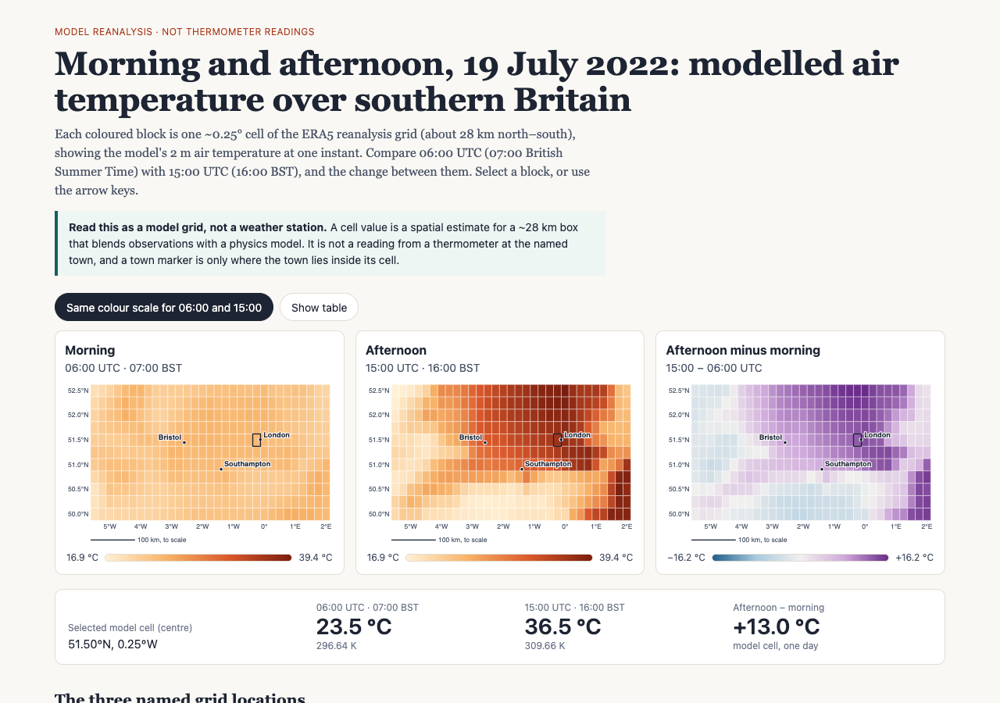

# Watch southern Britain warm over nine hours

[Explore the offline temperature maps](expected/index.html) · [Download the grid](expected/window.csv) · [Watch the browser](media/ui-film.webm)



A small, offline map page built from **two chunks** of Google's ARCO-ERA5 copy of the Copernicus/ECMWF ERA5
reanalysis, decoded by a Python script running inside the public [Computer](https://github.com/Lakeshore-Labs/computer)
CLI (Apache-2.0). Open `expected/index.html` in a browser; it needs no network.

These are **modelled reanalysis grid cells (0.25°, about 28 km)**, not weather-station readings. No safety advice,
impact or record claim is made.


The browser film and desktop and phone stills use the final offline map.

## What is sourced and what is calculated here

| Item | Origin |
|---|---|
| `2m_temperature` values in kelvin, the coordinate arrays, the time index | **Sourced, unmodified**: ARCO-ERA5 Zarr objects, pinned in `src/pins.json` |
| Blosc/LZ4 decoding, window cut (50.0–52.5 °N, 5.5 °W–2.0 °E, 11 × 31 cells, wraps 0° longitude) | **Calculated here** (`src/analyze.py`, pure stdlib; decodes 1 of 8 Blosc blocks per chunk) |
| K → °C (`K − 273.15`), 15:00 minus 06:00 difference, window min/max/mean | **Calculated here** |
| Nearest cell for London / Bristol / Southampton | **Calculated here**; the city coordinates are hand-typed approximations, not sourced |
| HTML, colours, layout | **Written here** (`src/template.html`) |
| `expected/window.csv`: `t2m_K` is the sourced value (float32 exact), `t2m_C` is calculated | mixed, per column |

Task attribution: **direct** work = everything in the "calculated/written here" rows, done by this task's scripts in
Computer; **source** work = the ERA5 reanalysis (ECMWF, Copernicus C3S) and its cloud-optimised republication (Google
Research ARCO-ERA5). Neither produced or reviewed this page. Full credit text: [`NOTICE.md`](NOTICE.md).

## Layout

```
run_era5.py            driver (stdlib only): --live fetch, replay, checks, optional native validation
src/                   analyze.py split.py fetch.sh template.html pins.json  (+ validate.py, capture.py: outside Computer)
snapshot/root.zattrs   176-byte snapshot of the one mutable upstream object (see below)
expected/              index.html window.csv results.json produced by the reference run (replays must match byte for byte)
checks/                driver check logs from the runs described in README.md
reference/             native zarr validation results from an EARLIER run, captured as such
media/                 desktop.png mobile-390.png ui-film.webm
manifest.json          sha256 of every file here
```
No upstream chunk is stored in this directory.

## Run it

Needs: the Computer binary (`go build -o computer ./cmd/computer`), its WASI CPython (`gh release download python-3.15.2-2
--repo Lakeshore-Labs/computer --pattern '*.tar.gz'`, extracted so that `python.wasm` and `lib/` sit in one directory), and Python 3.

```
# 1. download pinned objects (about 4.7 MB) inside Computer into a cache OUTSIDE this directory, then analyse
python3 run_era5.py --computer ./computer --python-wasi ./python-wasi --cache ~/era5-cache --out out1 --live
# 2. any number of offline replays from that cache (Computer gets no network at all)
python3 run_era5.py --computer ./computer --python-wasi ./python-wasi --cache ~/era5-cache --out out2
# 3. optional independent check with native zarr/numcodecs/numpy (a venv from src/validator-requirements.txt)
venv/bin/python run_era5.py ... --out out3 --validate
```
Exit status 0 means every requested check passed. `--probe-root` additionally reports whether the live store root has changed
since the snapshot (informational only). Paths may contain spaces; they may not contain `:` (Computer's `-mount` syntax).

## How the data is pinned

The store root `.zattrs` (`last_updated`, `valid_time_stop`, …) is rewritten whenever ARCO refreshes the dataset, so it is a
global mutable object whose old generation may disappear. This run saw `last_updated 2026-11-22 08:57:28Z` (generation
`1795337849146828`). Its exact bytes are shipped in `snapshot/root.zattrs` and verified by sha256; it is never fetched.
The consolidated `.zmetadata` (also mutable, ~133 KB) is never downloaded. Every other object (14) is read at its exact
GCS generation (`…?generation=N`) and must match `pins.json` on sha256, size, `X-Goog-Generation` and `X-Goog-Hash` md5.
If upstream deletes a pinned generation the fetch fails with HTTP 404 and the driver stops; it never falls back to the
current object. The temperature chunks (generations from September 2023) and the coordinate chunks are unchanged
data; the dataset's *current* extent is not what this page claims.

## Verification summary

* Computer replays are byte-identical to `expected/` (results.json sha256 starts `2b828d20…`).
* A fresh live replay passed 23 checks, including the native reader. Zarr 3.4.2, numcodecs 0.17.1 and NumPy 2.5.5 independently read all 341 values at both times and passed 22 comparisons. See [native checks](checks/native-zarr.json) and [the live replay](checks/live-and-native.json).
* Offline Chrome measured 341 cells in each of three maps at 1280 and 390 pixels, exercised cell selection and the shared scale, and recorded the final map. See [browser checks](media/browser.json).
* Observed `zarr_format` is **2**; "zarr-v3" is only the dataset's version label in the store name.

## Results (°C, model cell)
London 23.5 → 36.5 (+13.0); Bristol 23.7 → 32.0 (+8.3); Southampton 23.4 → 30.8 (+7.4).
Window mean 22.4 → 27.3; difference range −5.1 … +16.2.

The two times represent reanalysis grid cells. City labels select the nearest cell to a rounded city-centre coordinate. The two snapshots do not measure hourly peaks or individual thermometer readings. The native validator runs outside Computer.
