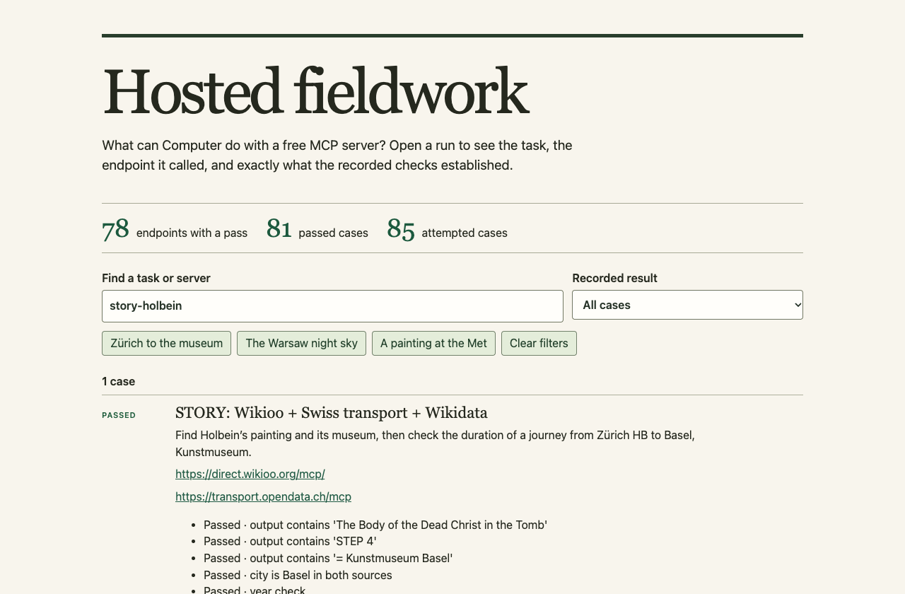

# A field guide to free hosted MCPs

[Open the offline survey](sample/fieldwork.html) to search 85 actual Computer runs. It includes all four cases that missed a check. The survey covers two November 22, 2026 cohorts. Of 85 attempted cases, 81 passed across 78 distinct endpoint URLs. Each run used an isolated workspace and public queries without a user account. Access policies and timetables can change.



The first cohort passed 56 of 59 cases across 55 unique endpoints. The second passed 25 of 26 cases across 23 additional endpoints. Two of its cases combine services already counted. The searchable survey includes each task, actual endpoint, timestamp and individual predicate. Some predicates check for a string or a source domain. Others compare independently obtained measurements. Open a run to see which test was applied. This survey samples the separate [MCP registry census](../registry-census).

## Three recipes to run

| Job | What Computer did | What the second run checked |
| --- | --- | --- |
| [Take a train to see Holbein](sample/story-holbein-basel-trip/transcript.txt) | Called Wikioo for a painting and its museum, read a Wikidata collection record over HTTPS and called Swiss public transport for a connection. | Both records identified Basel. Wikioo gave 1521 and Wikidata gave 1520. The later Zürich HB departure at 23:08 reached Basel, Kunstmuseum at 00:29, matching the quoted 81 minutes. No ticket was bought. |
| [Plan a Warsaw observing night](sample/story-warsaw-sky-night/transcript.txt) | Called two hosted astronomy services and ran independent solar and lunar approximations inside WASI Python. | The provider reported sunset at 15:35 local and the simplified formula gave 15:36. Both moon estimates rounded to 96%. The reported Geminid peak was December 14. |
| [Check a Van Gogh catalog entry](sample/still-met-van-gogh/transcript.txt) | Called a third-party artwork resolver and independently fetched the Metropolitan Museum of Art’s public record for object 436535. | All six fields agreed, covering title, artist, date, medium, required credit and the public-domain flag. |

Build the CLI and provision the WASI Python runtime as described in the [project README](../../README.md). From the repository root, run one of the listed case IDs. The output directory must be new.

```sh
python3 examples/hosted-fieldwork/replay.py story-holbein-basel-trip \
  --computer ./bin/computer --python-dir ./bin/python-wasi-2 \
  --output ./bin/holbein-trip
```

The runner passes only each recipe’s declared MCP endpoints and HTTPS prefixes. A new temporary workspace holds intermediate data. It saves the fresh transcript, SHA-256 and individual check results to your chosen directory. Historical survey records and subsequent replay receipts have separate timestamps. Source content, response formatting and live transport connections may change.

The [phone view](sample/phone.png), [browser film](sample/fieldwork.webm) and [browser receipts](sample/browser.json) show the offline search and failed-check filter. Rebuild the offline page with `python3 examples/hosted-fieldwork/build.py`. With Playwright Core and Chrome available, `node examples/hosted-fieldwork/record.cjs examples/hosted-fieldwork/sample/fieldwork.html /new/capture-directory` exercises both viewport sizes.
