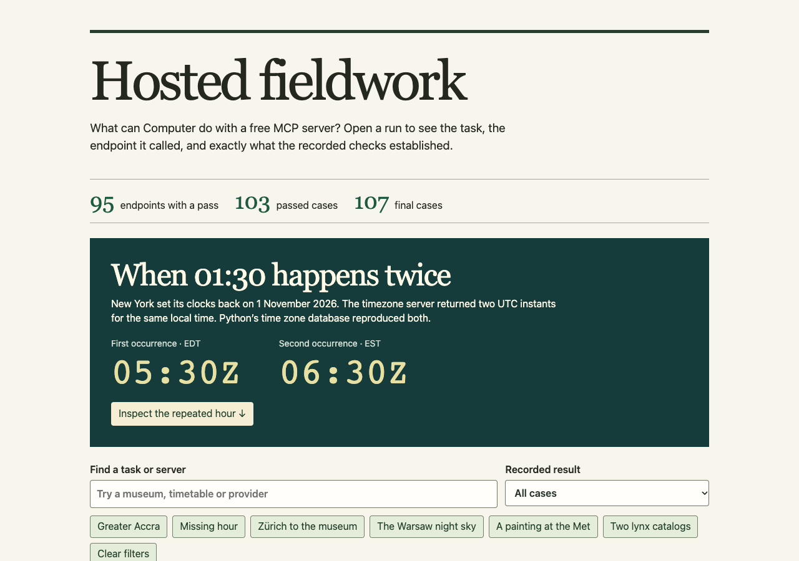

# Which 01:30 did you mean?

[](sample/four-cohorts.html)

Download and open [the four-cohort workbook](sample/four-cohorts.html). Choose **Inspect the repeated hour** to see the Computer command and its recorded checks. Search by task or provider, or choose **Missed a check** to inspect all four unsuccessful cases.

This edition adds thirteen observations from nine new, independently operated public URLs to the earlier 94-case survey. Stock Computer started with an empty home directory for every call. Its generated shell commands connected to remote MCP services over HTTP. The final run made all thirteen calls without credentials. Across four cohorts, 103 of 107 cases passed at 95 distinct endpoint URLs. These counts describe the captured runs. Two of the new checks only establish what appeared in a listing. An additional endpoint requested authentication during discovery and is excluded. [Recomputed counts](sample/counts.json) · [Call times, predicates and output digests](sample/checks.json) · [Initial verifier mistakes and discovery exclusions](misses.json)

* A local time of 01:30 during New York’s autumn transition resolved to both 05:30 and 06:30 UTC. The spring request correctly reported a missing wall-clock time. Its transition timestamp differed from the reference by 28.125 seconds.
* A four-chord progression transposed up a whole tone to D, A, Bm and G. E-flat Dorian returned seven notes and the expected sequence of whole and half steps.
* The Ghana census service returned 30,212,780 nationally and 5,295,246 for Greater Accra. The official 2021 totals are 30,832,019 and 5,455,692. The differences are 2.01% and 2.94%. The service discloses missing districts in its national coverage. Its regional result does not establish which districts explain the difference. [Ghana Statistical Service, 2021 census volume 3C, table 5.1](https://census2021.statsghana.gov.gh/gssmain/fileUpload/reportthemelist/2021%20PHC%20General%20Report%20Vol%203C_Background%20Characteristics_181121.pdf)
* Other calls checked a leap-year span, a Korean public calendar listing, an ISBN check digit, elementary arithmetic and two public catalogs. The workbook records exactly what was tested for each.

From this directory, regenerate the workbook using the committed observations:

```sh
python3 build.py
```

Use Python 3.11 or later for the live replay. Pass a fresh output directory. It records its own UTC timestamps, results and response hashes. Public URLs and data can change.

```sh
python3 replay.py --computer /path/to/computer --output /tmp/computer-reference-checks
```

To repeat the offline browser checks, install playwright-core in a temporary Node project, set NODE_PATH to its node_modules directory and CHROME to a Chromium executable, then run `node record.cjs`. The recorder exercises all thirteen new rows, the missed-case filter and both clock and census controls at desktop and phone widths.
