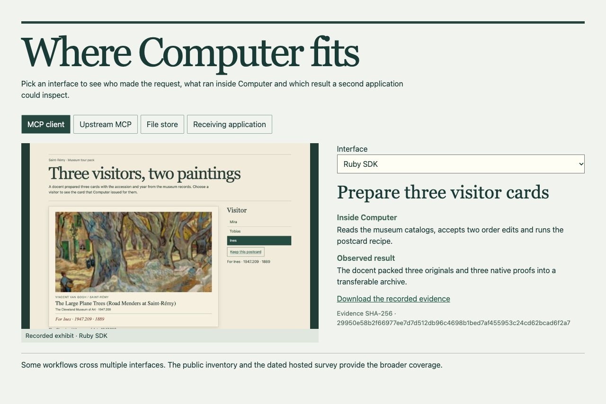

# Where Computer fits

[](sample/map.html)

Download [the standalone integration map](sample/map.html). Pick a role, then an interface. Each entry shows the task, Computer’s contribution and the result another application observed. Its evidence download preserves the exact original JSON bytes. The controls and images work offline.

There are 23 selected paths: 14 MCP client integrations, three upstream MCP workflows, four file stores and two downstream applications. The Node and browser TypeScript clients are separate delivery paths using the same SDK. The VS Code row records discovery and a native confirmation prompt. A completed tool call is evidenced for the other thirteen client paths. The six ferry entries share a capture of their common output open in Inspector. Each has its own recorded evidence.

The broader [capability atlas](../capability-atlas/), [four-cohort hosted workbook](../hosted-fieldwork/cohort4/), [storage comparison](../score-stores/) and [complete offline gallery](../offline-guide/) cover different questions. The counts overlap.

## Build and check

From the repository root:

```sh
uv run --with pillow==13.0.0 python examples/integration-map/build.py
```

The builder uses the [route list](routes.json), reads the original receipts, and embeds their SHA-256 digests and the actual exhibit images. Install playwright-core, set NODE_PATH and CHROME, then run `node examples/integration-map/check.cjs`. The offline replay used 1280- and 390-pixel viewports and matched all 46 downloaded receipts byte for byte. [Browser evidence](sample/browser.json)
