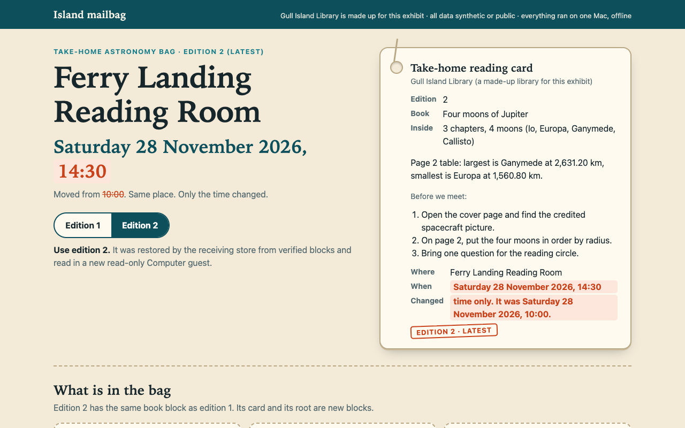

# Send an amended island book bag as CAR files

[Inspect the two editions](index.html) · [Watch the handoff](sample/mailbag.webm) · [Open the first CAR](car/edition-1.car) · [Open the amendment](car/edition-2.delta.car)



A small made-up island library packs a take-home astronomy bag: the original *Four moons of Jupiter* EPUB plus a short
reading card. It then amends the meeting **time** once and moves both editions between two independent content-addressed
stores as standard CARv1 / CIDv1 files. The second edition crosses as a **1,035-byte** CAR, because the receiving store
already holds the 121,382-byte book.

**The answer the bag gives:** meet at the Ferry Landing Reading Room, Saturday 28 November 2026, **14:30** (moved from 10:00, same place).
(The library, the room and the card are made up; the book is real.)

After dependency installation, the replay uses two local stores and transfers two CAR files on disk.

## What is in this folder

| path | what |
|---|---|
| `index.html` | the interactive page. One file, works offline from `file://`: switch editions, step through the handoff, verify the cards and your copy of the book with SHA-256 in the browser |
| `car/edition-1.car` | **download**: edition 1, 3 blocks, 122,395 bytes |
| `car/edition-2.delta.car` | **download**: edition 2 as a delta, 2 blocks, 1,035 bytes (the book block is not in it) |
| `receipts/` | compact measured results: `checks.json` (51 checks and every number), sender and receiver reports, manifests, the new guest's decision |
| `recipe/` | everything needed to replay and re-verify |
| `SOURCES.md` | attribution: the book, Computer, every library with version and license |
| `SHA256SUMS` | hashes of the published files |

The EPUB is **not** copied here. You use the original from a checkout of the Computer repository (below).

## The measured result

| | |
|---|---|
| Blocks sent across both CARs | 5, all different |
| Reused | 1: the book block, the same CID in both manifests, sent once (in `edition-1.car`) |
| Changed | 2: the card block and the root block |
| `edition-1.car` | 122,395 bytes, 3 blocks, SHA-256 `1368425b5aa1173afec64750f2e347ebb3f574de59d1f5c50b401fbeaf53e22c` |
| `edition-2.delta.car` | 1,035 bytes, 2 blocks, SHA-256 `2ae01f20f9ae816c4694ed3eac83cd353ffa53e8df9998baf42e502147aa74e5` |
| Edition 2 if sent whole (made to measure, never sent) | 122,456 bytes (SHA-256 `ea3d610590f886bca7da6ac994237988fe3f8d1467f09118cedd1c28da0de2dc`; the replay regenerates it) |
| Saved on the amended edition | 121,421 bytes = the book's 121,382 + 39 bytes of CAR framing |
| Book CID | `bafkreig3ivzb4xehlpa34k2lbbybgldq2bgs4cvg4knuq4u645ysnc4o4u` (raw, CIDv1, sha2-256) |
| Root CIDs | edition 1 `bafyreiapfhcpiwovzncwwbior2xd2dkppzem64nnc2ygvofdkxvmthc2v4`, edition 2 `bafyreiefwkzm6lj6p5giwtpx6r7jmqwojjdm6xz7uriexhq7q2kcunewpe` |
| Checks | 51/51 (`receipts/checks.json`); the new read-only guest passes 21/21 of its own; 4 writes through its read-only mounts are refused |

## How it works

| step | who | what |
|---|---|---|
| pack | a Computer guest, original book on a **read-only** mount | copies the book, writes the reading card from facts read out of the book |
| seal | Node: `blockstore-fs`, `@ipld/dag-cbor`, `@ipld/car` (Store A) | one raw block per file, one DAG-CBOR manifest linking them, written to `edition-1.car` |
| receive | Python: `carbox`, `libipld`, `hashlib`, SQLite (Store B) | re-hashes every block, stores them in one transaction, lists the CIDs it holds |
| amend | a second Computer guest, edition 1 mounted read-only | changes one line (the time) and writes edition 2 |
| delta | Node | withholds every block Store B said it holds, so only the new card and new root travel |
| refuse | Store B | a delta with one flipped byte is rejected (exit 3, store unchanged); the delta alone cannot restore edition 2 (exit 4, names the missing book CID, writes nothing) |
| consume | a **new** Computer guest, restored editions and Store B mounted read-only | re-derives the CIDs, opens the EPUB, queries Store B with `sqlite3 -readonly`, writes the decision; four more guests try to append, remove, mkdir and `DELETE` and are refused |

Store A and Store B share no directory, process or code: different language, library and layout, and B trusts nothing from A.
The exact byte formats are at the end of this file.

## Replay it yourself

### What you need

- A checkout of the **Lakeshore-Labs/computer** repository that contains `examples/moon-almanac/sample/four-moons.epub`. That file is in commit
  `71684674a05273f6c689b5d3c78d8e8f19d8191c` (branch `showcase/moon-almanac`), not on `main`. Check that commit out, or copy the one file.
  Confirm it: `shasum -a 256 .../four-moons.epub` must print `db45721e5c875bc1be2b4b0870132c70d04d2e0aa6e29b48729ee771268b8ee5`.
- A built Computer binary and its WASI Python directory (the checkout's `computer/bin/`): `bin/computer` and `bin/python-wasi-2/`
  (holding `python.wasm` and `lib/`). `bin/` is not tracked in git; build or obtain it as the Computer repository describes. The published
  receipts were made with a binary built from revision `ea7bf2356c67`.
- Node (tested with v26.12.0) and Python 3 (tested with 3.14.0 and 3.14.6; the Python patch version shows only in the `reader` label of the reports). `sqlite3` is **not** needed on the host: the guests carry their own.
- macOS was the only platform tested.

### Set up (once; about 6 MB of npm packages and a few MB of wheels)

Run these from this folder. Quote every path that has a space.

```sh
(cd recipe/node && npm ci --ignore-scripts)
python3 -m venv recipe/.venv
recipe/.venv/bin/pip install --only-binary :all: -r recipe/requirements.txt
```

### Replay

```sh
sh recipe/replay.sh \
  --out "/path/for/a/NEW/run directory" \
  --repo "/path/to/your/computer checkout" \
  --published car \
  --git-repo "/path/to/your/computer checkout"
```

- `--out` must not exist; the replay refuses to reuse a directory.
- `--repo` supplies three defaults, each of which you can override explicitly with `--epub FILE`, `--computer BINARY`, `--wasi DIR`
  (use these if the book and the binary are not in the same checkout; the EPUB file must be named `four-moons.epub`).
- `--published car` makes the replay decode the two published CARs with both readers and require them to be byte-identical to the ones it just made.
- `--git-repo` adds the check that the EPUB equals `git show 71684674…:examples/moon-almanac/sample/four-moons.epub`. It needs a checkout or clone that
  has that commit. Without it you get 50 checks instead of 51; the missing one is not counted as passed.
- `--python FILE` uses another Python that has `libipld` and `carbox` (default: `recipe/.venv/bin/python`, else `python3`).
- `--home DIR` is the guests' HOME. Computer compiles its Python there (about 28 MB). Default `OUT.home`, next to the run directory. Delete it when done.

A replay takes under a minute once Computer's cache is warm.

### What success looks like

The last lines are `51/51 checks passed`, then `IDENTICAL edition-1.car …` and `IDENTICAL edition-2.delta.car …`, then `replay complete`.
Any failed check, any difference from the published CARs, or any non-zero exit stops the script with a message.
The run directory then holds the guest transcripts, both stores, the restored editions (`restored/edition-N/`), and `checks.json`.

```sh
shasum -a 256 "RUN/boat/edition-1.car" "RUN/boat/edition-2.delta.car"    # must match car/ and SHA256SUMS
```

### Decode the published CARs without a replay

```sh
recipe/.venv/bin/python recipe/py/receive.py decode --car car/edition-1.car --report /tmp/py-1.json
node recipe/node/src/jsdecode.mjs car/edition-1.car /tmp/js-1.json
recipe/.venv/bin/python recipe/py/receive.py decode --car car/edition-2.delta.car --report /tmp/py-2.json
node recipe/node/src/jsdecode.mjs car/edition-2.delta.car /tmp/js-2.json
```

Each prints its block count and `hashes ok`. The JavaScript and Python reports agree on roots, CIDs and sizes.
(`libipld`'s own `decode_car` refuses CARs that contain raw blocks, so `carbox` reads the framing and `libipld` decodes the CIDs and DAG-CBOR;
`receipts/libipld-decode-car-probe.txt` shows the refusal.)

### Rebuild the page (optional)

```sh
recipe/.venv/bin/python recipe/page/build_index.py "RUN" /tmp/index-rebuilt.html
cmp /tmp/index-rebuilt.html index.html && echo identical
```

The page is rebuilt only from a run whose checks all passed, and embeds no run name or path, so a faithful replay gives the identical file.

### Use the page

Open `index.html` in a browser (double-click is fine). To check the book in the page, press "Check a copy of the book…" and pick your checkout's
`four-moons.epub`; the page embeds the two cards but not the book.

## Exact format

All written by libraries listed in `SOURCES.md`; nothing here assembles CID, CBOR or CAR bytes by hand.

- CIDv1 in base32 lowercase (`b…`); multihash sha2-256. A file is **one raw block** (codec `0x55`, `bafkrei…`): no chunking, no UnixFS.
  A manifest is one **DAG-CBOR block** (codec `0x71`, `bafyrei…`). The book's SHA-256 is the digest inside its CID.
- Manifest: `{schema: "island-mailbag/edition/v1", library, edition, files: [{name, mediaType, size, link: CID}, …]}`, canonical key order, `link` is CBOR tag 42.
  It has no link to the other edition, so the delta CAR's one missing block is exactly the block both manifests point at.
- CARv1: header `varint(len) + DAG-CBOR {roots: [root CID], version: 1}`, then per block `varint(len(CID)+len(data)) + CID + data`.
  `edition-1.car` holds root 1, card 1, book. `edition-2.delta.car` holds root 2, card 2: a valid CAR whose root links to a block it does not contain.
- Block sizes: book 121,382; card 1 523; card 2 584; each root 316.

| block | CID |
|---|---|
| book (both editions) | `bafkreig3ivzb4xehlpa34k2lbbybgldq2bgs4cvg4knuq4u645ysnc4o4u` |
| card, edition 1 | `bafkreih7gkzykdplnejv7jzen4nntjbtdeoanbi4gw4ny4d7667ll2nddi` |
| card, edition 2 | `bafkreig7pry4kvsi73vfgleat3z7hqfhyseatvebziov5eavb2l3phd3ji` |
| root, edition 1 | `bafyreiapfhcpiwovzncwwbior2xd2dkppzem64nnc2ygvofdkxvmthc2v4` |
| root, edition 2 | `bafyreiefwkzm6lj6p5giwtpx6r7jmqwojjdm6xz7uriexhq7q2kcunewpe` |

## Limits

- Local only: no IPFS upload, swarm, pinning or gateway. The two stores are two folders on one computer; "independent" means a different language,
  library, layout and process, not different machines.
- You need the EPUB from a checkout at the commit above and a Computer binary with its `python-wasi-2`; this folder does not contain or build either.
- Tested on macOS (arm64) only. Paths with spaces, `&` and `#` were tested; a colon (Computer's `host:guest` mount syntax) or a newline in a path is not supported.
- The card is plain Markdown written by a guest script; the book is not modified, re-packed or chunked.
- The receipts and CARs were made with a binary built from Computer revision `ea7bf2356c67`; other builds may differ in guest output text but the CARs do not depend on it.
- No license file is included. Choose one before publishing; `SOURCES.md` lists the licenses of everything used.
