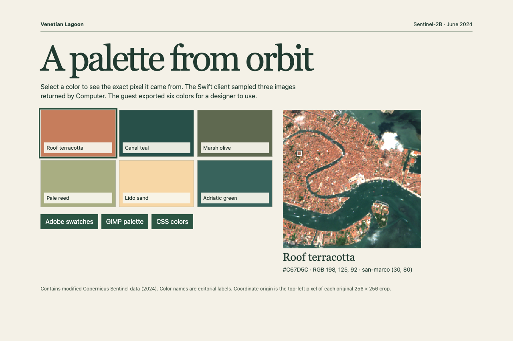

# A palette from orbit

Select a swatch in the [offline palette](sample/palette.html) to see its exact source pixel. Download the six colors as [Adobe Swatch Exchange](sample/venetian-lagoon.ase), a [GIMP palette](sample/venetian-lagoon.gpl), [CSS variables](sample/venetian-lagoon.css) or a [native macOS color list](sample/venetian-lagoon.clr).



A Swift client opens a stock Computer MCP server over stdio. It uses `read` to receive three actual PNG image blocks from the [Venice satellite windows](../lagoon-windows). Core Graphics samples six named pixels. The client calls `write` for its selection, uses `edit` to rename “Light sand” to “Lido sand”, and reads the result back. Its `bash` call runs WASI Python to export the offline board and three portable palette formats. Swift writes and independently reopens the fourth format with AppKit’s `NSColorList`.

For example, San Marco pixel (30, 80) is RGB (198, 125, 92), or `#C67D5C`. Lido pixel (202, 94) is RGB (247, 215, 166), or `#F7D7A6`. The names describe editorial selections from a Sentinel-2B true-color image acquired on June 28, 2024. The imagery contains modified Copernicus Sentinel data (2024).

## Replay on macOS

Use macOS 14 or later and Swift 6. The [pinned official Swift MCP SDK](client/Package.resolved) and its transitive packages are fetched on the first build. The workflow itself uses the three source PNGs from the checked-in satellite reader. From the repository root, use fresh output and scenes directories.

```sh
go build -o bin/computer ./cmd/computer
python3 examples/lagoon-palette/extract.py bin/palette-scenes
swift build --package-path examples/lagoon-palette/client
examples/lagoon-palette/client/.build/debug/LagoonPalette \
  "$PWD/bin/computer" "$PWD/bin/python-wasi-2" "$PWD/bin/palette-scenes" \
  "$PWD/examples/lagoon-palette/recipe" "$PWD/bin/palette-output"
```

The WASI runtime directory must contain `python.wasm` and `lib`. The source and recipe mounts are read-only. The generated files land in the new output directory. The Apple color list is written to an explicit file there.

## Verification

AppKit reopened all six native colors. Pillow decoded the original PNGs and GIMP palette. The independent `ase-utils` decoder read every ASE entry. Chrome sampled the actual displayed pixels and downloaded each portable palette, with external requests blocked at both desktop and phone sizes. The [film](sample/palette.webm), [phone capture](sample/phone.png), [browser measurements](sample/browser.json) and [Swift receipt](sample/swift.json) are included. Adobe applications were not run.

```sh
uv run --with pillow python examples/lagoon-palette/verify.py bin/palette-scenes bin/palette-output
npm install --prefix bin/palette-verifiers ase-utils@0.1.1 playwright-core
NODE_PATH="$PWD/bin/palette-verifiers/node_modules" node examples/lagoon-palette/verify-ase.cjs bin/palette-output
NODE_PATH="$PWD/bin/palette-verifiers/node_modules" node examples/lagoon-palette/record.cjs bin/palette-output bin/palette-capture
```
