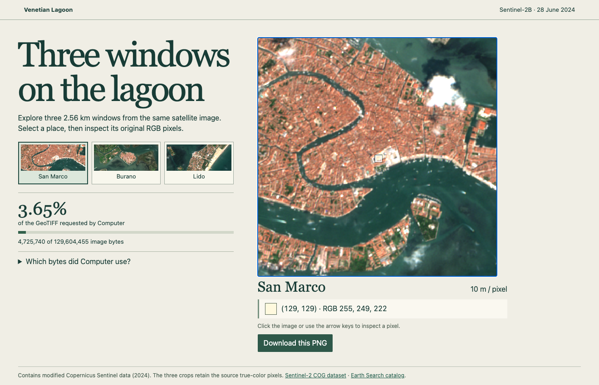

# Read three small windows from a satellite image of Venice

Open San Marco, Burano or Lido. Click a pixel or use the arrow keys to read its exact RGB value. Each image covers 2.56 × 2.56 km at ten metres per pixel. The three PNGs and the inspector work offline in one HTML file. [Download the pixel inspector](sample/lagoon.html?raw=true) · [Watch the recorded inspection](sample/windows.webm) · [Phone capture](sample/phone.png)

[](sample/lagoon.html?raw=true)

## What Computer reads

A guest STAC query found a June 28, 2024 Sentinel-2B acquisition in Element 84's Earth Search catalog. Its true-color asset is a **129,604,455-byte** Cloud Optimized GeoTIFF in public S3. Starting with a **16,384-byte** TIFF header, WASI Python reads the tile directory and works out which blocks cover the three selected windows.

The guest shell sends three more HTTP range requests to that same allowed object. WASI Python decompresses the blocks, reverses the TIFF horizontal predictor, stitches pixels across a block boundary at San Marco and writes lossless PNGs. A separate invocation packages the images into the offline reader. Together, the four partial responses contained **4,725,740 bytes**, or **3.6463%** of the full TIFF. The original catalog search and the independent reader's traffic are outside this image-payload measurement.

| Compressed block | Start byte | Bytes read |
| ---: | ---: | ---: |
| 61 | 82,346,709 | 1,995,232 |
| 71 | 90,240,562 | 988,871 |
| 72 | 91,229,433 | 1,725,253 |

Rasterio with GDAL independently opened the remote GeoTIFF, projected all three geographic coordinates and read the corresponding pixel rectangles. All **196,608 RGB pixels** matched the guest's PNGs exactly. On desktop and phone, Chrome checked the canvas RGB digest, moved the sample cursor by keyboard, read a known pixel and downloaded each original PNG byte-for-byte. [Remote GDAL checks](sample/independent.json) · [Tile offsets and crop digests](sample/windows.json) · [Browser checks](sample/browser.json)

## Replay the live reads

Build the stock CLI and prepare WASI Python using the repository README. The replay addresses the pinned object with its ETag and checks for HTTP 206 on every request. It reads the three image blocks once, including the one shared between two windows. The Python code supports the observed TIFF layout.

```sh
python3 examples/lagoon-windows/replay.py --computer ./bin/computer \
  --python-dir ./bin/python-wasi-2 --output ./bin/venice
uv run --with rasterio==1.4.3 python examples/lagoon-windows/verify.py ./bin/venice
```

To repeat the desktop and phone recording, use Google Chrome, Playwright Core and its matching FFmpeg helper. Run `NODE_PATH=/path/to/node_modules node examples/lagoon-windows/record.cjs ./bin/venice ./bin/venice-recording` after the independent verification. The initial catalog query is saved separately and can be opened in a browser or fetched using guest curl. [Catalog query](source/search-url.txt) · [Original STAC record](source/item.json) · [S3 range receipt](source/probe.json)

Contains modified Copernicus Sentinel data (2024). Sensor Sentinel-2B, Level-2A, true-color asset. The crops preserve the original RGB values. Sentinel-2 COGs are available on the AWS Open Data Registry and discoverable through Element 84 Earth Search. [Dataset](https://registry.opendata.aws/sentinel-2-l2a-cogs/) · [Earth Search collection](https://earth-search.aws.element84.com/v1/collections/sentinel-2-l2a)
