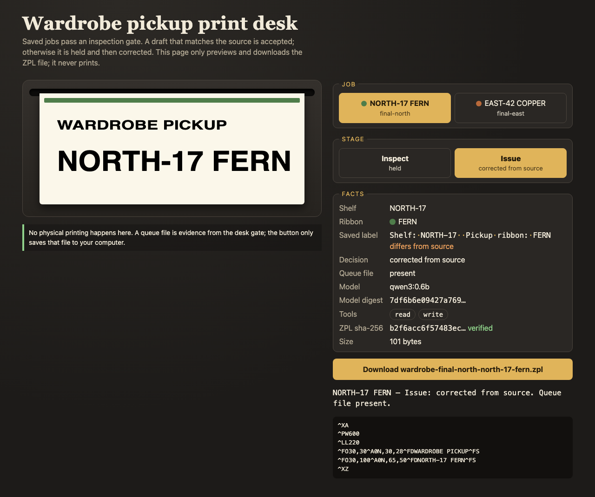

# Issue a wardrobe label with a local model

[Open the offline print desk](sample/desk.html) · [Watch the two jobs](sample/screencast.mp4) · [Download the NORTH-17 ZPL](sample/final-north/desk/ticket.zpl)



Computer’s built-in agent used Ollama on loopback with Qwen3 0.6B. In each run the model requested a read of the order from a read-only mount. A new Computer process reopened the saved conversation with `agent -c`. The model requested a write to a separate writable mount. The second prompt contained neither the shelf number nor the ribbon color.

Both captured drafts included the right shelf and ribbon, plus extra field labels. A WASI Python program inspected each draft and held the queue empty. It then issued a corrected Zebra Programming Language job from the two source fields, preserving the original draft. The north job is 101 bytes and the east job 102. A separate acceptance control passed an exact draft through the same inspection and issued the ticket immediately.

The reader previews the ZPL and downloads its exact bytes. No printer was connected. The two receipts record the model digest, tool names, returned answers, draft, source digest, decision and final file digest. [North receipt](sample/final-north/receipt.json) · [East receipt](sample/final-east/receipt.json) · [Browser downloads](sample/verify.json)

## Replay

Use an installed Ollama model that supports tools, the stock Computer executable, built JS agent bundle, QuickJS WASI engine and WASI Python distribution. The captured model was `qwen3:0.6b`, digest `7df6b6e09427a769808717c0a93cadc4ae99ed4eb8bf5ca557c90846becea435`, served by Ollama 0.31.1. Choose new output directories. Model tool calls and text can vary.

```sh
for job in north east; do
  python3 examples/local-model-labels/replay.py --computer ./bin/computer \
    --bundle ./agent/js/dist --engine ./bin/local/qjs-wasi.wasm \
    --python-dir ./bin/python-wasi-2 --endpoint http://127.0.0.1:11434 \
    --job "$job" --out "./bin/labels-$job" || exit 1
done
python3 examples/local-model-labels/reader/build_reader.py \
  ./bin/labels-north ./bin/labels-east ./bin/label-reader
```

The publisher accepts a correctly formatted draft immediately. If inspection holds the draft, the correction uses only the validated read-only order. This example uses fictional garment pickups and runs entirely on the local machine after installation.
