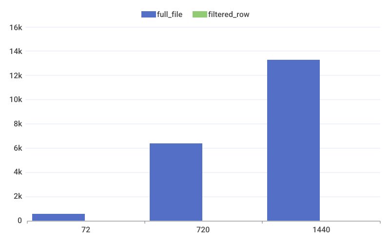

# What reaches Gemini?

Both live requests answered **trip 1438, 25 riders**. The Filesystem MCP returned the same synthetic source data in each case. Forwarding the full 1,440-row CSV to the answer prompt used 13,338 input tokens. Forwarding the row selected inside Computer used 55. Both responses used seven output tokens.



| Trip records | Full-file prompt | Filtered prompt |
| ---: | ---: | ---: |
| 72 | 612 | 53 |
| 720 | 6,417 | 54 |
| 1,440 | 13,338 | 55 |

## What was measured

The host generates a CSV behind an official read-only Filesystem MCP. In one path it reads the file through a direct MCP client. In the other, it makes one call to Computer's outer `bash` tool. The generated `timetable read-text-file` command reads the same source, and a shell pipeline selects the last Pier departure. The host checks both outputs against the independent fixture and applies the same question template in both paths.

Google's `countTokens` measured all six prompts. Two native `generateContent` requests at 1,440 rows returned the same answer and confirmed the recorded input-token counts in their usage metadata. The provider identified the model as Gemini 3.5 Flash-Lite. The host chose the filter before the model requests. The figures cover the answer prompt. They exclude any extra turns an agent might take to discover tools or write its own query. The experiment makes no claim about monetary cost.

## Draw the recorded result offline

Build the CLI from the repository root. Computer needs read access to the saved data and a fresh output mount.

```sh
CGO_ENABLED=0 go build -o ./bin/computer ./cmd/computer
mkdir -p ./bin/model-input-chart
./bin/computer -mount ./bin/model-input-chart:/work -mount ./examples/model-input/sample:/sample:ro \
  -c 'chart bar --x trips --y full_file,filtered_row /sample/tokens.csv --out tokens.png'
```

## Repeat with the model

Install the pinned Filesystem MCP and make a Gemini API key available through the environment. The live replay sends synthetic CSV data and the question to the named provider. It issues six token-count requests and two generation requests. The upstream server has a read-only input folder. The Python SDK launches Computer as a separate stdio MCP server.

```sh
npm install --prefix ./bin/model-input-servers @modelcontextprotocol/server-filesystem@2.4.0
uv run --with mcp==2.3.0 python examples/model-input/measure.py \
  --computer ./bin/computer --filesystem ./bin/model-input-servers/node_modules/.bin/mcp-server-filesystem \
  --output ./bin/model-input-live
```

[Read the actual measurements and provider usage](sample/measurement.json) · [Inspect the chart data](sample/tokens.csv) · [Read the experiment](measure.py)
