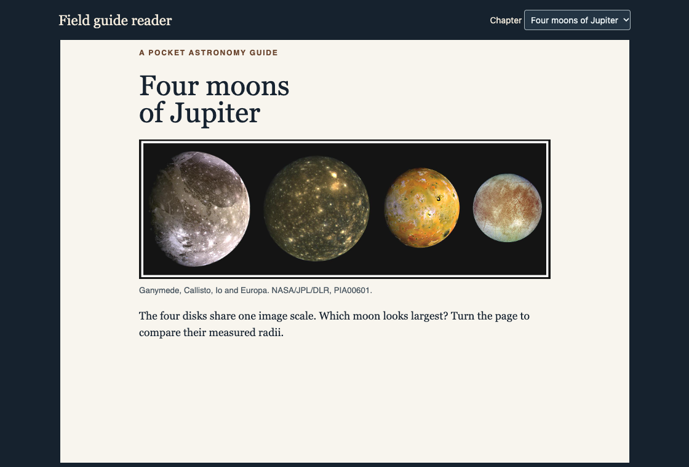

# Read four moons of Jupiter offline

A school librarian can take a three-chapter astronomy guide into a classroom with no network. Download the EPUB and open it in a reader. The opening page carries a credited spacecraft composite, the second compares measurements, and the last links the original scientific and image records. [Download the book](sample/four-moons.epub) · [Watch the reader](sample/reading.webm) · [Phone view](sample/phone.png)

[](sample/four-moons.epub)

## What Computer does

A guest command calls the Wikimedia-hosted Wikidata MCP server to find four entities whose parent body is Jupiter. Guest curl reads JPL’s satellite table and the original JPEG. WASI Python joins the records by satellite name and builds an EPUB with standard ZIP, XHTML, metadata, a navigation document and a reading order. The resulting book is 121,382 bytes. It contains the original 1,870 × 635 NASA/JPL/DLR image.

| Moon | JPL mean radius (km) | Quoted uncertainty (km) |
| --- | ---: | ---: |
| Io | 1,821.49 | 0.50 |
| Europa | 1,560.80 | 0.30 |
| Ganymede | 2,631.20 | 1.70 |
| Callisto | 2,410.30 | 1.50 |

The offline capture retains the four original JPL table rows, the Wikidata MCP response, the image and their provenance. A separate live replay produced the same EPUB digest. Pandoc read all four measurements. W3C EPUBCheck 5.4.0 reported zero diagnostics. EPUB.js 0.3.93 opened all three chapters, decoded the full image and rendered all four rows at desktop and 390-pixel phone widths, with no requests to external sites during either reading session. [Both replay receipts](sample/checks.json) · [EPUBCheck output](sample/epubcheck.txt) · [Browser checks](sample/browser.json)

## Replay

Install Pandoc on the host. Use a Computer CLI and the project’s WASI Python release. The default replay uses the captured sources and a fresh output directory.

```sh
python3 examples/moon-almanac/replay.py --computer ./bin/computer \
  --python-dir ./bin/python-wasi-2 --output ./bin/moon-book
```

Add `--live` with a new output directory to query Wikidata and NASA again. The live sources can change. The publisher itself runs without a network capability and needs only the mounted files.

To repeat the browser capture, install `epubjs@0.3.93`, `jszip@3.10.1` and `playwright-core` in a local directory, with the matching Playwright FFmpeg binary and Google Chrome available. Point Node at that directory’s installed packages.

```sh
NODE_PATH=/path/to/node_modules node examples/moon-almanac/record.cjs \
  ./bin/moon-book ./bin/moon-reading
```

[Guest publisher](recipe/publish.py) · [Wikidata query](recipe/moons.rq) · [Source hashes and links](sources/receipt.json) · [JPL physical parameters](https://ssd.jpl.nasa.gov/sats/phys_par/) · [NASA/JPL/DLR photograph PIA00601](https://science.nasa.gov/photojournal/the-galilean-satellites-3/)
