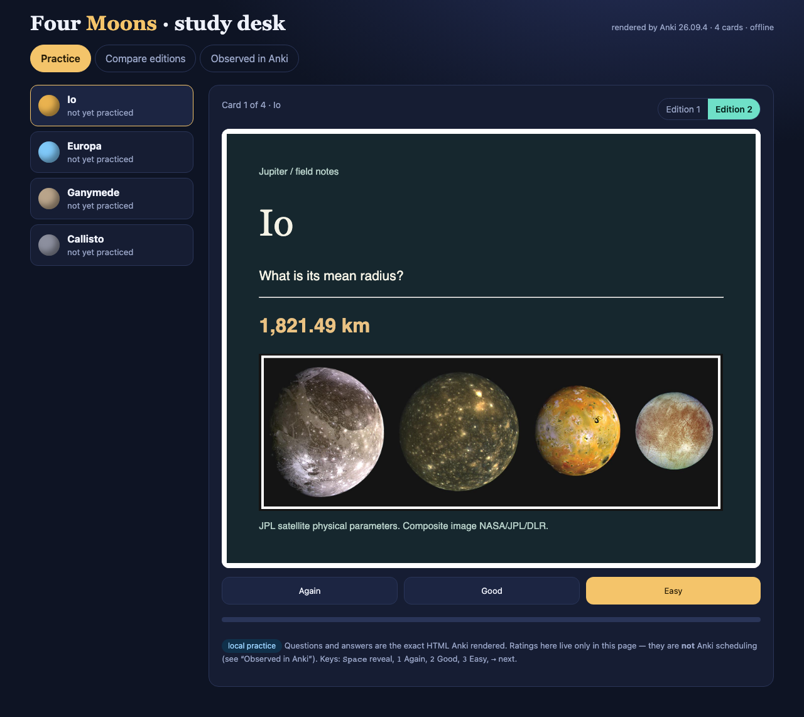

# Amend a moon study card without losing its review history

[Try the offline study desk](sample/desk/index.html) · [Watch the four views](sample/study.mp4) · [Download edition one](sample/edition-1.apkg) · [Download the amendment](sample/edition-2.apkg)



A librarian takes the original *Four moons of Jupiter* EPUB into a study group. Computer reads the book’s XHTML measurement table and image, then uses genanki inside WASI Python to issue four real Anki cards. The next edition adds the quoted measurement uncertainty to Europa’s answer. Stable note identifiers let a learner import the amendment after studying.

The official Anki 26.9.4 Python package and Rust backend imported edition one into an empty collection. Its scheduler recorded one Easy review of Europa. On import of edition two, Anki reported **one updated note, three duplicates and zero new notes**. Europa’s answer became **1,560.80 km (±0.30 km)**. Its card ID, review log and scheduling survived closing and reopening the collection. The three other notes and cards retained their fields and modification times. The test temporarily suspended the other three cards to bring Europa to the front of the scheduler, then restored them.

The browser presents the question and answer HTML rendered by Anki and allows local practice. The recorded import and scheduling decisions came from the real backend. The independent stdlib reader also opened a new-format export and found four notes, four cards and one review. [Official consumer receipt](sample/workflow-receipt.json) · [Independent export check](sample/independent-read-updated-deck-export.json) · [Original EPUB, measurements and image credits](../moon-almanac/README.md)

## Replay

The guest imports the five verified packages listed in `recipe/packages.json`. The host can reuse its download directory with `--cache`. Choose new output and verification directories.

```sh
python3 examples/moon-cards/replay.py --computer ./bin/computer \
  --python-dir ./bin/python-wasi-2 --output ./bin/moon-decks --cache ./bin/moon-deps
uv run --python 3.13 --with anki==26.9.4 python -I examples/moon-cards/checks/verify_workflow.py \
  ./bin/moon-decks/edition-1.apkg ./bin/moon-decks/edition-2.apkg ./bin/anki-check
python3.14 -I examples/moon-cards/checks/independent_read.py \
  ./bin/anki-check/updated-deck-export.apkg ./bin/anki-check/independent.json
```

The observed edition was opened in a temporary local collection. The two downloadable source decks contain the four cards and the public NASA/JPL/DLR image. The separate [updated deck export](sample/updated-deck-export.apkg) also contains the synthetic learner’s review. [Anki’s packaged deck guide](https://docs.ankiweb.net/manual/importing/packaged-decks) · [genanki](https://github.com/kerrickstaley/genanki)
