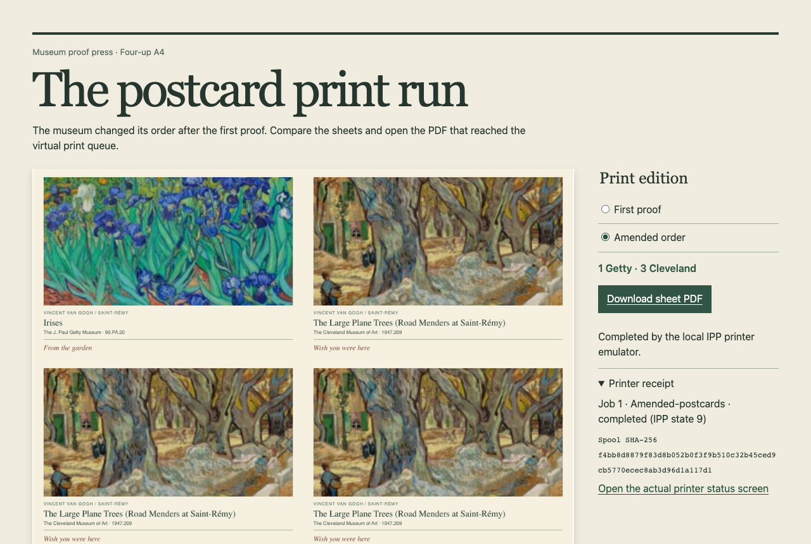

# Send the amended museum sheet to a virtual print queue

[](sample/index.html)

[Compare the proofs offline](sample/index.html) · [Download the submitted PDF](sample/amended/sheet.pdf) · [Open the actual printer status screen](sample/queue.png)

The first order called for three Getty cards and one Cleveland card. The amended order reversed the quantities. Computer’s WASI Python placed four original A6 postcards on each A4 landscape page and wrote a print ticket naming each slot and the finished PDF’s checksum.

A native adapter used CUPS ipptool to send just the amended PDF to an isolated IPP Everywhere emulator. The emulator reported **one completed job**. Its retained spool file matched the Computer-generated PDF byte for byte. This is a digital print rehearsal. The run used a temporary loopback printer and produced no paper. [Submission and spool receipt](sample/receipt.json) · [Independent queue screen](sample/queue-browser.json)

The original art and inscriptions are the SVGs downloaded from the browser MCP postcard press. The host converted those two SVGs to single-page PDFs with librsvg. The guest imposed both orders with pypdf. Poppler rendered the original PDFs and both complete sheets independently. A native pixel comparison identified the artwork in all eight positions. Text extraction also reproduced both inscription counts. [Eight quadrant comparisons](sample/pixel-checks.json) · [Original museum credits](../museum-study/README.md) · [Browser postcard press](../postcard-press/README.md)

## Rebuild and submit locally

Install the project WASI Python release, librsvg, Poppler, CUPS ipptool and ippeveprinter, and Python with Pillow. Start from the repository root with a fresh output directory.

```sh
uv run --with pillow==13.0.0 python examples/museum-print-run/replay.py \
  --computer ./bin/computer --python-dir ./bin/python-wasi-2 --output ./bin/museum-print-run
```

Open the generated index.html to compare both editions. The replay creates and stops its own emulator on an available loopback port. It does not configure a system printer. The PDF checksums, queue name and CUPS status are recorded in the output directory. CUPS uses IPP state 9 for a completed job. [OpenPrinting emulator manual](https://openprinting.github.io/cups/doc/man-ippeveprinter.html)

To capture the native status page, install playwright-core, set NODE_PATH to its node_modules directory and CHROME to a Chromium executable. Add `--capture examples/museum-print-run/check/capture_queue.cjs` to the replay. Then run `node examples/museum-print-run/check/capture_desk.cjs ./bin/museum-print-run` to test both downloads offline at desktop and phone widths.
