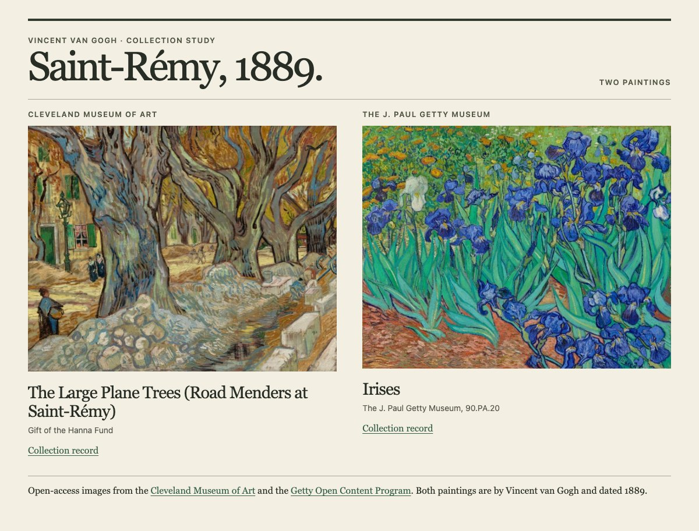

# Bring two museum collections into one reading room

[](sample/study.html?raw=true)

Open the downloaded HTML to compare *The Large Plane Trees (Road Menders at Saint-Rémy)* from Cleveland and *Irises* from the Getty. Both paintings date to 1889. Each caption links to its museum’s collection record.

A Go host configures rclone’s combine backend with two source directories. It opens the resulting rclone VFS in the same process and supplies it as a read-only Computer mount through afero. The guest lists the two collections, hashes their original images, reads the museums’ different metadata formats, resizes both JPEGs and lays out a portable HTML study. Its two input directories can stay separate.

The source JPEGs contain 332,102 and 172,425 bytes. The standalone HTML contains both reduced images. A separate parser compared those embedded bytes with the guest’s JPEG outputs and verified the credits and original checksums. Offline Chrome decoded both images, displayed the works side by side on desktop and stacked them at 390 pixels. [Verification](sample/verification.json) · [Browser receipt](sample/browser.json) · [Phone capture](sample/phone.jpg)

## Rebuild from captured sources

```sh
python3 examples/museum-study/replay.py --output ./bin/museum-captured
```

The first build needs Go and access to the public modules in the host’s separate module file. Subsequent runs can use the module cache. The captured replay makes no requests to the museums. Open `bin/museum-captured/study.html`. A fresh output directory is required.

## Fetch new museum copies through Computer

```sh
CGO_ENABLED=0 go build -o ./bin/computer ./cmd/computer
python3 examples/museum-study/replay.py --live-computer ./bin/computer \
  --output ./bin/museum-live
```

The fetch recipe permits five source URLs. It reads Cleveland’s collection record and its web-size image, Getty’s IIIF manifest and 600-pixel image, and Getty’s Linked Art object record for the date. Both image records identify the works as open access. Captured metadata contains just the fields used for the study.

## Check the browser view

With Chrome and Node installed, run the following from the checkout root.

```sh
npm install --prefix ./bin/museum-browser playwright-core@1.66.0-alpha-2026-11-18
NODE_PATH="$PWD/bin/museum-browser/node_modules" node examples/museum-study/record.cjs \
  ./bin/museum-captured/study.html ./bin/museum-captured
```

### Collection credits

Vincent van Gogh, *The Large Plane Trees (Road Menders at Saint-Rémy)*, 1889. Cleveland Museum of Art, Gift of the Hanna Fund, 1947.209. Cleveland provides the image under its CC0 Open Access program. [Collection record](https://www.clevelandart.org/art/1947.209) · [Open Access](https://www.clevelandart.org/open-access)

Vincent van Gogh, *Irises*, 1889. The J. Paul Getty Museum, 90.PA.20. The Getty IIIF manifest identifies the image as CC0 under the Getty Open Content Program. Getty credits its descriptive text to the J. Paul Getty Trust, licensed under CC BY 4.0. [Collection record](https://www.getty.edu/art/collection/object/103JNH) · [IIIF manifest and usage statement](https://media.getty.edu/iiif/manifest/53be857e-41e8-4198-b45d-2e0f52d3051b) · [Getty API documentation](https://data.getty.edu/museum/collection/docs/)
