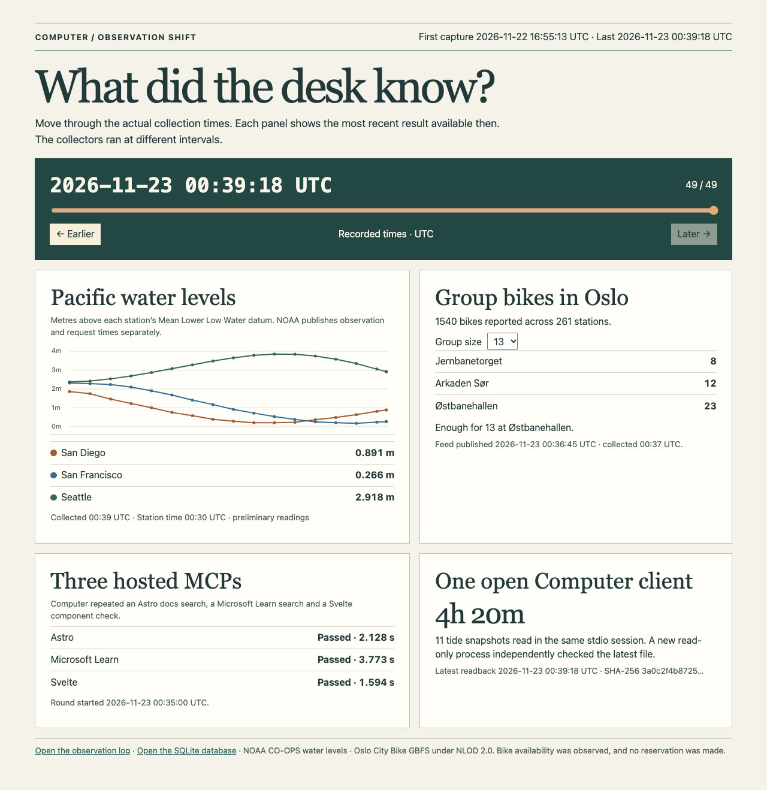

# Rewind a shift of real observations

[Open the offline shift desk](sample/shift.html) · [Watch the comparisons](sample/shift-desk.mp4) · [Download the SQLite database](sample/shift.sqlite) · [Read the timeline CSV](sample/timeline.csv)



Move the clock to a capture time. Each panel uses the latest data it had received by that time. The first capture has water levels only. Later captures add bike availability at three Oslo stations, timed responses from three hosted MCPs, and a Computer client that stayed connected while tide files arrived.

The completed sample runs from 16:55:13 UTC on November 22 to 00:39:18 UTC on November 23, 2026. It contains 18 tide batches (54 readings at 51 distinct station and observation-time pairs), 14 Oslo feeds, 18 hosted operations and 11 readbacks by one persistent client. Chromium checked 196 time and group-size combinations against SQLite. A fresh read-only Computer independently verified every persistent-client readback. The four collectors started at different times. The database retains collection and source timestamps where available.

## What Computer did

Computer collection jobs read NOAA water levels and official Oslo City Bike GBFS feeds. Another stock Computer repeatedly called Astro, Microsoft Learn and Svelte MCPs. The persistent Python MCP client kept one Computer process open, read newly arrived source files from a read-only mount and wrote the results into its workspace.

Here another stock Computer opens the frozen observations and publishes the SQLite database, timeline and self-contained HTML with WASI Python. A host-side verifier recomputes the tables and the visible series from the original measurements. Chromium compares every capture time at four group sizes with independent SQLite queries. [Source measurements](source/observations.json) · [Host audit](sample/audit.json) · [Browser checks](sample/browser.json)

## Replay the frozen sample

Use the project WASI Python release and a new output directory. The replay uses only the bundled observations and the local executable.

```sh
python3 examples/observation-shift/replay.py --computer ./bin/computer \
  --python-dir ./bin/python-wasi-2 --output ./bin/shift-replay
```

NOAA water levels use metres relative to each station’s Mean Lower Low Water datum. The original quality flags are retained. Oslo City Bike publishes GBFS availability under NLOD 2.0. The station counts describe a past observation. Hosted response digests identify the observed replies. [NOAA CO-OPS](https://api.tidesandcurrents.noaa.gov/api/prod/) · [Oslo City Bike open data](https://oslobysykkel.no/en/open-data)
