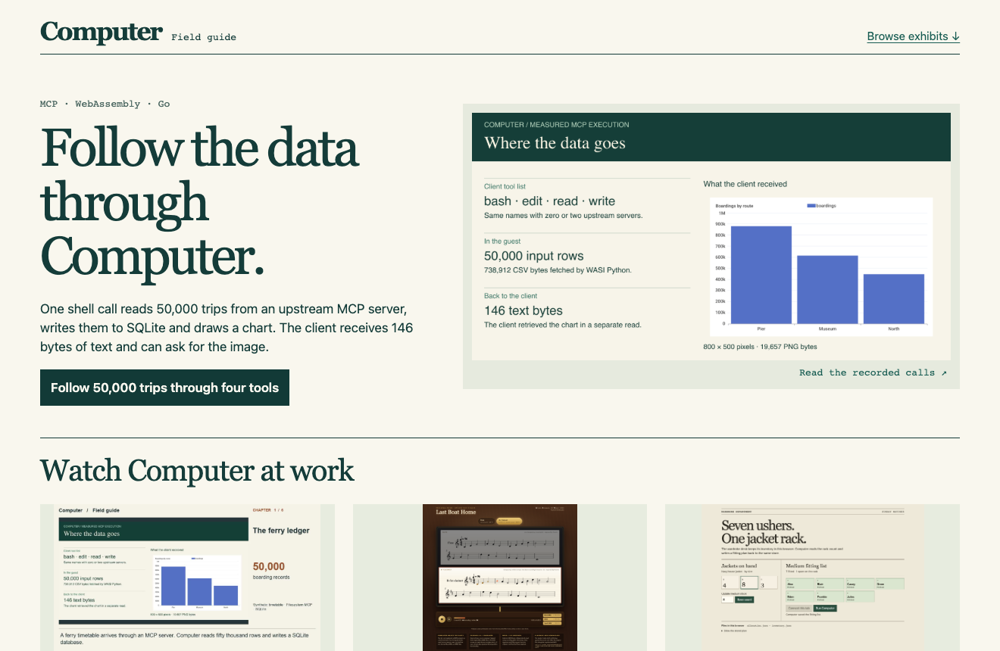

# Take the Computer field guide offline

[](computer-field-guide.zip?raw=true)

[Download the field guide](computer-field-guide.zip?raw=true) · [Browse the full exhibit index on GitHub](catalog.md)

Extract the ZIP and open `index.html` in a browser. Search for a tool, file store or task. Each exhibit includes an observed result and its evidence. The six-chapter film, engraved rehearsal score, wardrobe recount, satellite pixel reader, GIS models and other exhibits work from disk. Public replay and attribution links open external sites.

| Try this | What Computer does | What another interface verifies |
| --- | --- | --- |
| Watch the 79-second field film | Six chapters trace each guest, client and reader’s contribution. | The offline player offers captions, chapter jumps, a separate MP4 and the transcript. |
| Play one tune on two instruments | Two shells use a compiled WASI command to write standard MIDI and MusicXML parts. | Verovio engraves the music, Apple AudioToolbox reads both parts and the browser plays the opening. |
| Fit seven ushers offline | A wardrobe MCP gives the guest two tools for stock and fittings. | The browser writes eight jackets offline and recovers the completed fitting list after restart. |
| Pick colors from Venice | A Swift MCP client uses Computer to produce six colors from satellite tiles. | Native AppKit reads the color list. The offline page exports four palette formats. |
| Compare two Oslofjord models | Writes two closed 13,428-face STL solids from the same real elevation grid. | Rotate both, then scrub the 30 and 84 deposited layers from CuraEngine. |
| Find ten bikes in Oslo | Writes a shapefile and reads projected geometry from GDAL’s GeoPackage. | Change group size, choose from three feed times, or open the GIS files in another client. |
| Take Jupiter into a classroom | Joins Wikidata and JPL measurements and packages a NASA/JPL/DLR image in a real EPUB. | EPUBCheck validates the book and EPUB.js reads all three chapters. |
| Issue a lost-property claim | Writes a printable PDF and a QR image. | Quirc and Apple Vision decode the same synthetic claim. |
| Compare two Van Gogh paintings | Joins Getty and Cleveland files through a native rclone VFS, resizes the two images and writes an offline study. | A browser decodes the exact thumbnails in two desktop columns or a single phone column. |
| Update a festival program | TypeScript and Java clients use Computer to publish and amend a lobby page and calendar. | A read-only Python subscriber checks stable event IDs, and Chrome downloads the exact revised ICS. |
| Listen to three tide stations | Synthesizes one timed note for each observed NOAA level and packages the tracks in HTML. | A waveform reader checks note pitch against the measurements. The browser plays each track offline. |
| Repair the bakery sales board | Calls Chrome DevTools MCP and writes a repaired HTML file in WASI Python. | Lighthouse checks the original and revised pages. |
| Compare the Great Lakes in winter and summer | Fetches four dated NASA scenes and bundles them into a single HTML application. | An offline browser changes dates and moves the image divider. |
| Find a ferry trip in 1,440 records | Queries an upstream filesystem inside the shell and passes the selected row to Gemini. | Native provider usage records 55 input tokens for the selected-row prompt and 13,338 for the full-file prompt. Both answer the same trip and rider count. |
| Try two dispatch plans | Runs the same shell over separate writable in-memory filesystems with a shared base. | A Go host reopens and compares all three schedules. |
| Read a changing blob selection | Mounts a Go Cloud bucket backed by the official local Azure Blob emulator. | Independent rclone reads match the files used for both thumbnails. |

## What the numbers count

The November 22, 2026 edition contains 215 exhibits. There are 31 featured stories, ten runtime chapters, 48 command recipes, 27 storage exhibits, nine local MCP workflows and 90 successful hosted cases. Several exhibits can exercise the same client, API or filesystem.

The hosted survey contains 94 final cases, of which 90 passed across 86 distinct endpoint URLs. Thirty-three passing cases share a documentation search-and-read pattern. Repeated tools or shared operators do not establish independent protocol implementations. The archive’s scope page and the [hosted fieldwork](../hosted-fieldwork/) describe the checks, four final misses and capture times. The catalog also records the editor’s native confirmation prompt and partial storage results.

## Verify the package

The verification program uses the Python standard library. It checks archive integrity, local HTML references (including video posters), and the evidence file for every exhibit. It prints the archive digest and generates the index published alongside the download.

```sh
python3 examples/offline-guide/verify_bundle.py > /tmp/computer-exhibit-index.md
diff -u examples/offline-guide/catalog.md /tmp/computer-exhibit-index.md
```

## Connect an MCP client to the guide


The same ZIP can be the data source for a local MCP server. Build the server from this directory and it embeds the exhibits, receipts and downloadable documents in one binary. Start the binary over stdio with MCP Inspector or another MCP client.

```sh
CGO_ENABLED=0 go build -o ./bin/field-guide ./examples/offline-guide
```

The `search` tool finds exhibits by words in their titles, categories and descriptions. It returns up to twelve matches and the total match count. Pass an offset to read the next matches in stable ID order. The `show` tool accepts one of those IDs and returns the evidence document plus a PNG or JPEG when the exhibit has one. An MCP client can also list seven named resources and read their data directly. Clients that support resource templates can open the JSON evidence for any exhibit using `guide://exhibits/{id}`. For example, searching for the Oslo bike group returns `oslo-group`, whose recorded decision is available at `guide://exhibits/oslo-group`. The official Python client replay compares every templated resource byte-for-byte with its file in the ZIP.

| Resource | Content |
| --- | --- |
| `guide://dispatch/sheet` | Printable PDF |
| `guide://dispatch/workbook` | Excel workbook |
| `guide://observations/great-lakes` | Self-contained satellite comparison HTML |
| `guide://festival/original` | Original three-screening calendar in iCalendar format |
| `guide://festival/amended` | Updated calendar with stable event UIDs and revised times |
| `guide://collections/saint-remy` | Self-contained museum study with both collection images and credits |
| `guide://observations/pacific-listening-room` | Self-contained player with three recorded tide tracks and observation tables |

MCP Inspector can list the resources directly with `npx -y @modelcontextprotocol/inspector@2.13.0 --cli ./bin/field-guide --method resources/list`.

To explore it inside Computer, start the field-guide server as an upstream MCP. The following example assumes a repository path without spaces. Use a Computer JSON config with separate command and argument fields for other paths.

```sh
CGO_ENABLED=0 go build -o ./bin/computer ./cmd/computer
mkdir -p ./bin/guide-work
./bin/computer -mount ./bin/guide-work:/work -mcp "guide=$PWD/bin/field-guide" \
  -c "guide search --query 'bakery chrome' | jq -r '.items[].title'"
```

The replay uses the Python MCP SDK to read the PDF and compare the two calendars, museum study and tide player byte for byte with the archive. A second connection lists Computer’s four tools, calls its shell to select a bakery exhibit and save the upstream image, then reads the resulting PNG. The replay compares both files byte for byte against the archive. The recorded PDF is 1,983 bytes. The PNG returned through Computer is 100,352 bytes. Run it with a fresh output directory. [Captured MCP receipt](mcp-receipt.json)

```sh
uv run --with mcp==2.3.0 python examples/offline-guide/replay.py \
  --guide ./bin/field-guide --computer ./bin/computer --output ./bin/guide-result
```
