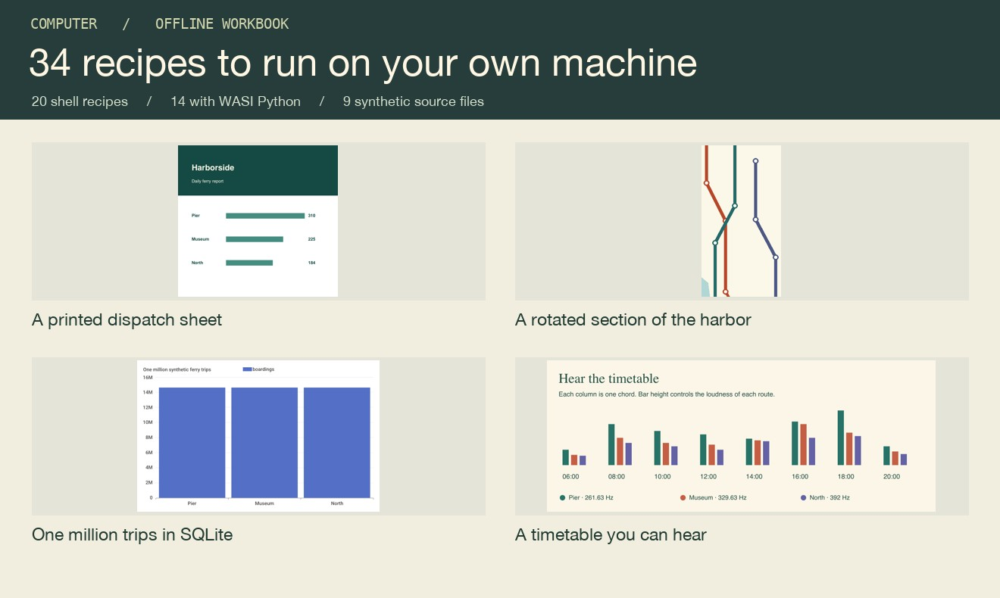

# Run 34 Computer recipes offline



Start with the Computer executable and nine synthetic ferry fixtures. Each recipe runs in a fresh writable directory with the fixtures mounted read-only. Twenty recipes use the built-in shell and commands. Fourteen also run WASI Python. The guest gets no network access and the recipes start no service.

## Try one

```sh
CGO_ENABLED=0 go build -o ./bin/computer ./cmd/computer
python3 examples/offline-workbook/replay.py
python3 examples/offline-workbook/replay.py --computer ./bin/computer \
  --output ./bin/first-recipes chart-line archive-checksum image-thumbnail
```

Open `bin/first-recipes/chart-line/line.png` and the thumbnail in the neighboring output directory. Each recipe retains its own standard output, errors and produced files. The top-level `results.json` records exit status, output assertions, artifact lengths and SHA-256 digests. Choose a new output directory for each run.

## Try them all

After obtaining the project's WASI Python release, supply its directory. Choose `core` for the twenty recipes that run without WASI Python, `python` for the fourteen that use it, or `all` for the complete workbook.

```sh
python3 examples/offline-workbook/replay.py --computer ./bin/computer \
  --python-wasi ./python-wasi --output ./bin/full-workbook all
python3 examples/offline-workbook/check_outputs.py ./bin/full-workbook
```

The independent format check opens the SQLite database, tar archive, WAV stream and spreadsheet XML with the host Python standard library. It verified one million database rows, eight spreadsheet formulas and cached values, and 79,360 audio samples. The full workbook passed in two fresh output directories. PDF and workbook producers may include run timestamps.

## Find a recipe

### Shell and SQL

- [Archive the timetable and verify its contents](scripts/archive-checksum.sh)
- [Find the busiest departure across three routes](scripts/awk-peak.sh)
- [Join route names and capacities across formats](scripts/join-routes.sh)
- [Find departures carrying at least 45 riders](scripts/route-selector.sh)
- [Read the largest ferry capacity from YAML](scripts/service-yaml.sh)
- [Create a database in Python and query it from the shell](scripts/sqlite-handoff.sh) · WASI Python
- [Rank ferry traffic with a SQL window function](scripts/sqlite-window.sh)
- [Aggregate three routes directly from a CSV](scripts/xan-profile.sh)

### Charts and images

- [Compare ferry routes by departure](scripts/chart-bar.sh)
- [Plot a day of passenger traffic](scripts/chart-line.sh)
- [Show the distribution of Pier passengers by time](scripts/chart-pie.sh)
- [Show each route’s passenger counts by departure](scripts/chart-scatter.sh)
- [Write a vector chart to standard output](scripts/chart-vector.sh)
- [Crop and rotate part of the transit map](scripts/image-cut.sh)
- [Transcode a map to GIF, TIFF and BMP](scripts/image-formats.sh)
- [Flip a route map on its horizontal and vertical axes](scripts/image-mirror.sh)
- [Make a WebP map small enough for an email](scripts/image-thumbnail.sh)
- [Flatten a transparent ferry icon onto a chosen background](scripts/image-transparency.sh)

### Python

- [Read gzipped manifests without expanding them to disk](scripts/compressed-stream.sh) · WASI Python
- [Summarize ridership with the Python standard library](scripts/python-statistics.sh) · WASI Python
- [Publish a daylight-saving-aware departure time](scripts/time-zones.sh) · WASI Python
- [Write and validate a TOML service manifest](scripts/toml-roundtrip.sh) · WASI Python

### Documents

- [Turn a Word briefing into text and HTML](scripts/docx-reading.sh) · WASI Python
- [Search a PDF briefing through SQLite full-text indexing](scripts/library-search.sh) · WASI Python
- [Convert Markdown to HTML and back](scripts/markdown-roundtrip.sh) · WASI Python
- [Convert the public timetable to Markdown](scripts/notice-to-markdown.sh)
- [Typeset a two-page operations brief inside WebAssembly](scripts/pdf-brief.sh) · WASI Python
- [Extract and render one page from a PDF](scripts/pdf-split.sh) · WASI Python
- [Render a shareable service notice from YAML](scripts/template-report.sh) · WASI Python
- [Build a workbook with formulas and a chart, then read it back](scripts/xlsx-brief.sh) · WASI Python

### Field notes

- [Summarize a million trips before returning an answer](scripts/million-records.sh)
- [Hear eight departures as a three-note harbor score](scripts/sonify.sh) · WASI Python

### File stores

- [Keep the source timetable read-only](scripts/readonly.sh) · WASI Python

### Runtime

- [List the command binaries available in this mount](scripts/shell-inventory.sh)

[Input fixtures](fixtures/) · [Expected outputs](recipes.json) · [WASI Python setup](../../README.md#python)
