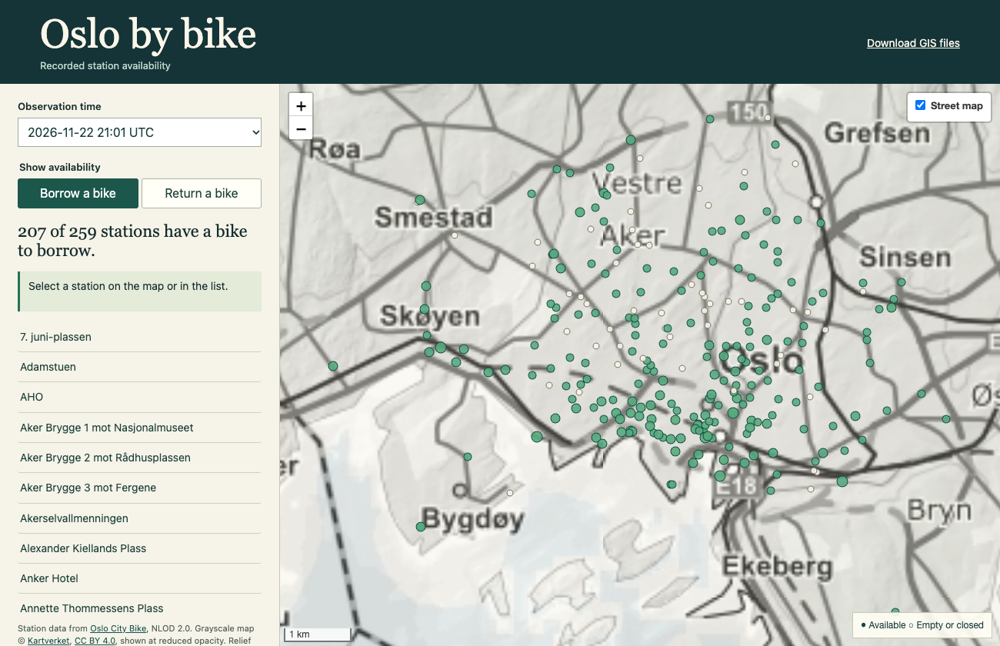
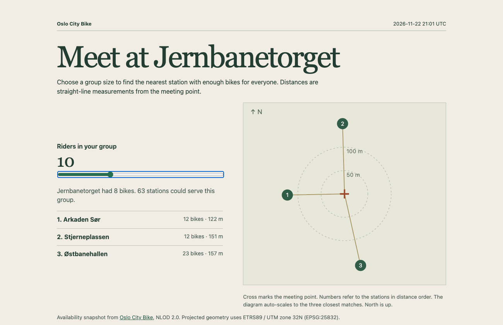

# Find ten bikes near Jernbanetorget

Ten people meet at Jernbanetorget. The recorded station had eight bikes. The nearest station that could take the whole group was Arkaden Sør, with twelve bikes about 122 metres away in a straight line. Change the group size to see when a different station becomes the closest choice. [Open the group selector](sample/meeting.html) · [Watch the recorded map and group decision](sample/desk.webm)

[](sample/map.zip)

Download and unzip the two-page desk. **map.html** switches between three observed feed times, borrowing, returning, a grayscale map and terrain. Select a station or download the shapefile. **meeting.html** reads the captured shortlist produced from the GeoPackage. Both pages open offline. [Download the offline desk](sample/map.zip) · [Station shapefile](sample/oslo-stations.zip) · [Projected GeoPackage](sample/stations.gpkg)

## The recorded choice

At 21:01 UTC on November 22, 2026 there were 261 station geometries, 259 installed stations and 207 stations with at least one bike available to rent. Sixty-three could serve the ten-person group. Straight-line distances use ETRS89 / UTM zone 32N. Walking routes and reservations are outside this calculation.

| Station | Available bikes | Distance from meeting point |
| --- | ---: | ---: |
| Arkaden Sør | 12 | 122 m |
| Stjerneplassen | 12 | 151 m |
| Østbanehallen | 23 | 157 m |

[](sample/meeting.html)

## What Computer and the readers do

1. A Computer guest fetched Oslo City Bike's GBFS files through allowed HTTPS URLs using an identifying header. Three snapshots and their original hashes are in the capture.
2. WASI Python loads the pinned pure-Python PyShp wheel from a read-only mount. It writes WGS 84 point geometry, attributes, a projection, an encoding declaration and a reproducible ZIP. Uninstalled stations retain their geometry and have missing bike counts.
3. The guest builds an offline Leaflet reader. The browser's shapefile library parses the binary geometry and DBF. The two browser layouts checked the borrow and return counts at all three times, read station 478, switched the basemap and downloaded identical GIS bytes.
4. On the host, Fiona 1.10.1 with GDAL 3.9.2 opened the ZIP and compared every name, coordinate and availability record with the original feed. It projected the points into a native GeoPackage.
5. A second Computer invocation read the GeoPackage through WASI SQLite. It decoded the geometry blobs, measured distances and published the group selector. An independent browser test calculated great-circle distances directly from the raw feed and checked the three closest names and distances for groups of one, ten and thirty. [GeoPackage checks](sample/native.json) · [Recorded group choice](sample/meeting.json) · [Browser receipts](sample/browser.json)

## Reproduce the desk

Build the stock CLI and prepare its WASI Python distribution following the repository README. The captured replay needs no network. The optional GIS step needs Fiona on the host.

```sh
python3 examples/oslo-bike-desk/replay.py --computer ./bin/computer \
  --python-dir ./bin/python-wasi-2 --output ./bin/oslo-map
uv run --with fiona==1.10.1 python examples/oslo-bike-desk/replay.py \
  --computer ./bin/computer --python-dir ./bin/python-wasi-2 \
  --output ./bin/oslo-group --gis
```

Add `--live` with a fresh output directory to append a new provider snapshot. Results vary with bicycles, station installations and service changes. To repeat the film and browser checks, install Playwright Core, its FFmpeg helper and Google Chrome. Run `NODE_PATH=/path/to/node_modules node examples/oslo-bike-desk/record.cjs ./bin/oslo-group ./bin/oslo-recording`.

Station data come from Oslo City Bike under NLOD 2.0. Four zoom-11 grayscale tiles © Kartverket are displayed at reduced opacity under CC BY 4.0. Mapzen Terrain Tiles supply the shaded relief. Norway terrain © Kartverket. Europe terrain uses Copernicus data funded by the European Union, EU-DEM layers. Natural Earth supplies the public-domain coastline. The archive includes software license notices and member digests. [Source manifest](source/manifest.json) · [Oslo City Bike](https://oslobysykkel.no/en/open-data/realtime) · [Kartverket terms](https://www.kartverket.no/en/api-and-data/terms-of-use) · [Elevation source](https://registry.opendata.aws/terrain-tiles/)
