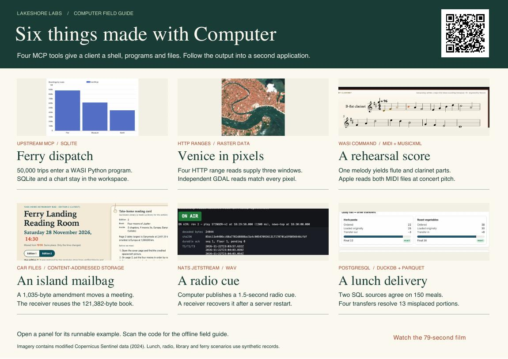

# Six things made with Computer

[Download the one-page printable field guide](sample/pocket-guide.pdf) · [Read its print verification](sample/print-check.json)

[](sample/pocket-guide.pdf)

Each panel links to a runnable example. The six original captures cover the ferry chart, satellite pixels, a printed clarinet part, an amended island reading card, a recovered radio cue and a balanced lunch delivery. The QR code opens the 215-exhibit portable field guide. The bottom right opens the narrated film. Contains modified Copernicus Sentinel data (2024).

The host crops six existing public images using Pillow. Inside Computer, WASI Python composes the page with FPDF, generates the vector QR with Segno and embeds the six original JPEG streams with pypdf. The host and guest each have a distinct role. Poppler independently renders the page at 144 DPI, verifies its dimensions and extracts its eight link annotations. Apple Vision reads the QR from that full-page raster.

## Replay

Run from the repository root with the stock Computer executable, the project WASI Python release and a new output directory. The host verifies the same pinned Segno wheel as the claim-ticket example. An existing wheel can be passed with `--wheel` for an offline run.

```sh
uv run --with pillow==13.0.0 python examples/pocket-guide/replay.py \
  --computer ./bin/computer --python-dir ./bin/python-wasi-2 --output ./bin/pocket-print
python3 examples/pocket-guide/verify/verify.py \
  --pdf ./bin/pocket-print/pocket-guide.pdf --out ./bin/pocket-proof
```

The independent print check uses Poppler and Swift with Apple Vision on macOS. The [crop manifest](sample/crop-sources.json) identifies each original image, rectangle and source digest.
