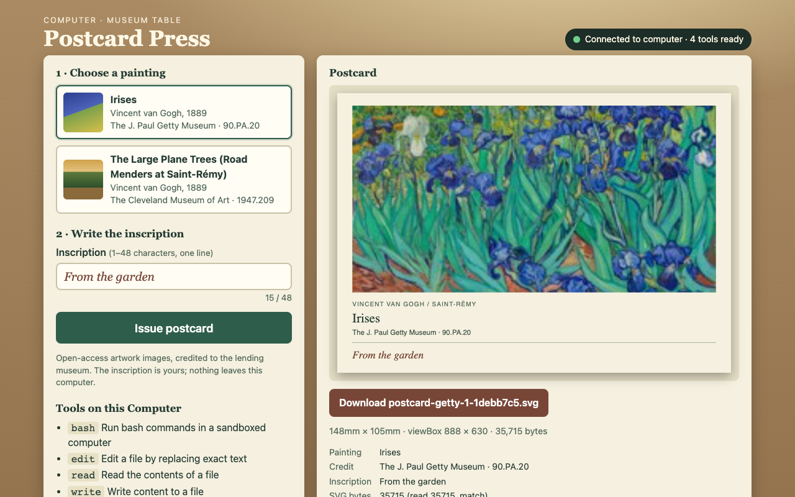

# Issue a museum postcard from a web browser

[](sample/proofs.html)

[Open the offline proof sheet](sample/proofs.html) · [Watch both desktop orders](sample/desktop-film.mp4) · [Open the phone capture](sample/phone.png)

Choose a painting, add an inscription and download the A6 card. The live browser is an MCP client. It discovers Computer’s four tools over Streamable HTTP. It uses **write** for the first order, **edit** to change the order, **bash** to run the WASI Python press and **read** to retrieve the finished SVG. The browser checks the guest’s byte count and SHA-256 before enabling the download.

The Go host mounts the two museum collections and the recipe read-only. It gives one Computer an in-memory work directory. Computer’s image command makes the thumbnails, then its guest reads the source museum record, sets the caption and embeds the JPEG in the standalone file. The desk is shared by clients connected to this single local process. Restarting it starts a fresh desk.

In the recorded visit, the Getty card used 35,715 bytes and the Cleveland card used 31,310. In a second browser context, a different Cleveland inscription produced 31,326 bytes. A separate official Python MCP client reopened that file on the running server, compared it to the browser download, checked the source and thumbnail hashes, and rendered the SVG with librsvg. Another run verified two paintings with a Unicode inscription containing XML punctuation and a repeat order. [Browser calls and downloads](sample/browser.json) · [Independent reader](sample/python-client.json) · [Repeat-order checks](sample/reissued.json)

## Run the local press

From the repository root, install Node.js, Go and the project's WASI Python release. The reader assets are bundled from npm at build time.

```sh
npm ci --prefix examples/postcard-press/ui
npm run --prefix examples/postcard-press/ui build
go run ./examples/postcard-press/host \
  -collection examples/museum-study/sources \
  -recipe examples/postcard-press/recipe \
  -ui examples/postcard-press/ui/dist \
  -python-dir ./bin/python-wasi-2
```

Open the loopback address printed by the host. Leave the process running to read a card from another client. Install the official Python SDK and librsvg’s rsvg-convert, then specify the press address, an unused output directory and the file downloaded from the browser.

```sh
uv run --with mcp==2.3.0 python examples/postcard-press/observe.py \
  --endpoint "$PRESS_ADDRESS" --output ./bin/postcard-readback --download "$DOWNLOADED_SVG"
```

For the browser replay set CHROME to your Chrome or Chromium executable and install FFmpeg. Run `node examples/postcard-press/ui/capture/capture.mjs "$PRESS_ADDRESS" ./bin/postcard-capture`. The independent repeat-order check accepts the same address, a fresh output path and the executable of a Python environment with the MCP SDK.

The images and original collection metadata come from the museum study. Both museums identify the images as open access. [Getty collection](https://www.getty.edu/art/collection/object/103JNH) · [Cleveland collection](https://www.clevelandart.org/art/1947.209) · [Pinned input files and acquisition recipe](../museum-study/README.md)
