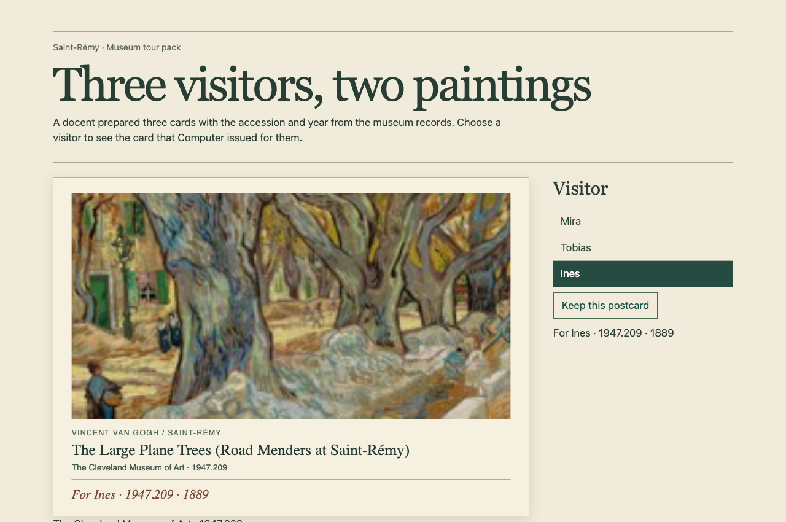

# Pack three museum postcards with the official Ruby client

[](sample/index.html)

[Choose a visitor offline](sample/index.html) · [Take the complete tour pack](sample/tour-pack.tar.gz) · [Read the 15 tool calls](sample/operator-receipt.json)

A docent prepares souvenirs for Mira, Tobias and Ines. Ruby’s official MCP client reads the two museum catalogs from Computer, takes the accession and year from each original record and puts them in the visitor’s inscription. The first order uses write and the next two use edit. Computer runs its WASI recipe and the client reads the finished SVG and receipt for each card.

Mira and Tobias receive different editions of the Getty’s *Irises*. Ines receives Cleveland’s *The Large Plane Trees*. Each SVG includes the museum image, credit and inscription. Native librsvg renders three PNG proofs. Ruby packages the originals, proofs and operator receipt into a tar.gz archive. Two fresh batches produced identical archive bytes. A separate Python MCP client read Ines’s last card from the live desk and matched the same 31,330 bytes. [Independent readback](sample/independent-client.json) · [All six desktop and phone downloads](sample/browser.json)

## Replay

Start the [local postcard press](../README.md) and set PRESS_ADDRESS to its printed loopback address. Use a fresh press for the batch. From this directory, set up Bundler with Ruby 4, install librsvg, and run:

```sh
bundle config set --local path vendor/bundle
bundle install
SOURCE_DATE_EPOCH=315619200 bundle exec ruby docent_tour.rb "$PRESS_ADDRESS" ./new-tour
python3 build_reader.py ./new-tour/tour-pack.tar.gz ./new-tour/index.html
```

Open new-tour/index.html. Ruby 4.0.9, the official mcp gem 1.11.0 and Bundler 4.0.20 were used for the capture. The lock includes the HTTP transport dependencies. The reader opens the archive, checks all six original file hashes and embeds the three SVGs for offline selection and download. The museum credits and open-access image provenance are in the [original study](../../museum-study/README.md).
