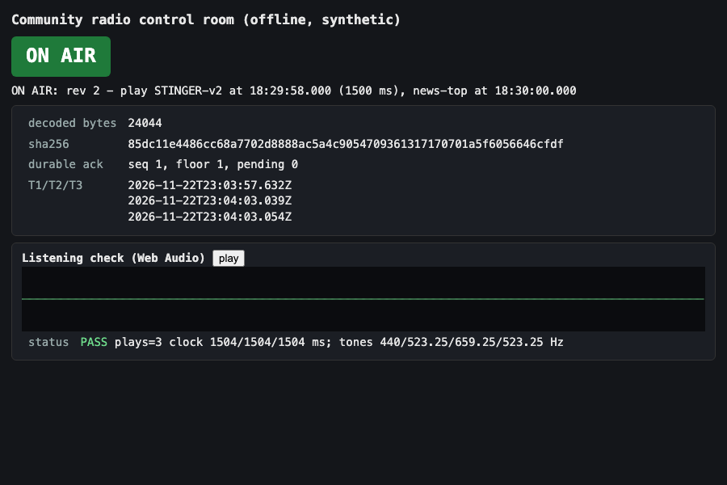

# Deliver a radio cue to a receiver that connects after a restart

[Listen in the offline control room](evidence/run-2/control-room.html) · [Watch the recording](evidence/run-2/capture.mp4) · [Download the actual WAV](evidence/run-2/cue.wav)

A radio producer needs to deliver a 1.5-second station cue for a two-second slot. Inside Computer, WASI Python synthesizes the sound, stores it in NATS JetStream and publishes the amended rundown through three generated MCP tool bindings. The receiver connects after the server restarts. It retrieves 24,044 bytes of audio, checks their digest against the producer’s and acknowledges sequence 1. The durable consumer then has zero pending messages.

**Computer tool names** (from the generated CLI / Python bindings; the MCP server is named `nats` in the config):
- Python (used): `from tools import nats` then `nats.nats_obj_create_bucket`, `nats.nats_obj_put`, `nats.nats_stream_publish`
- CLI (one read-back call): `nats nats-obj-info --bucket CUES --name stinger-v2.wav.b64`. The CLI equivalents are `nats nats-obj-create-bucket`, `nats nats-obj-put`, `nats nats-stream-publish`.

**Flow.** Node creates stream `RUNDOWN` and the existing durable `receiver-a` (receiver offline). The guest generates and reads its own WAV, base64-encodes it (mcp-nats `obj_put` takes a UTF-8 string, so the stored object is ASCII base64), and makes the three upstream calls (bucket, put, publish the amended rundown) before writing `producer-proof.json`. The server is stopped and restarted, then the receiver connects late, fetches, reads the object with raw `getBlob`, decodes and checks sha256/bytes/duration/slot, `ackAck`s, and shows the ON AIR decision. `verify.mjs` independently re-reads the object and consumer state. With `--chrome/--ffmpeg`, a browser plays the decoded bytes three times through Web Audio (SHA-256 re-check, audio-clock vs wall time, Goertzel tone check) and records a ~7.7 s screencast plus desktop and mobile images.

## Run (caller supplies every binary; nothing is hard-coded)
    ./run.sh --computer PATH/computer --python-dir PATH/python-wasi  \
             --nats-server PATH/nats-server --mcp-nats PATH/mcp-nats/dist/index.js \
             --out NEW_EMPTY_DIR [--runs 2] [--node node] [--node-modules DIR_WITH_nats] \
             [--chrome PATH --ffmpeg PATH]
`--python-dir` holds `python.wasm` and `lib/`. `--mcp-nats` may be a native executable or the `dist/index.js` (run with `--node`). Without `--node-modules`, `npm ci` installs the pinned `nats` into each run's app dir (needs registry access).

Optional, tested on macOS arm64 (checksum-verified official downloads, put outside this tree): `./fetch-macos.sh NEWDIR` prints the `--nats-server` and `--mcp-nats` values.

## Upstream (not included)
nats-server v2.15.3 (Apache-2.0, nats-io/nats-server releases); mcp-nats 0.1.7 (MIT, Gooseus/mcp-nats, npm tarball sha1 fedf6ba47e557124ed1d38e363d32de2b7f44fbe, gitHead 98c1b20b92546b4207a0d60c143c772dda7d874e); nats.js 2.29.3 (Apache-2.0).

## Limits
The browser check measures the Web Audio clock and the rendered samples in headless Chrome. It does not prove a person heard speakers. Run time and `nats-server` ports are ephemeral. Only synthetic data is used. `evidence/` holds compact proof from two fresh runs (no logs or dependencies).
