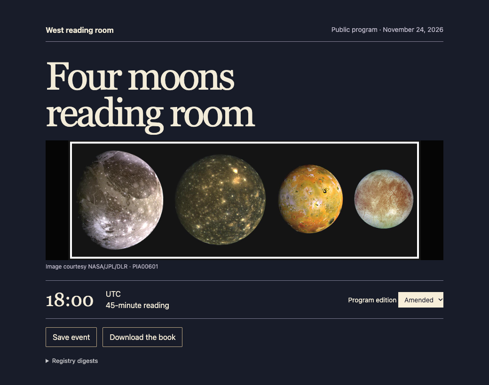

# Deliver two reading-room programs through an OCI registry

The library moves a reading group from 17:30 to 18:00 UTC. Its e-book stays the same. Computer publishes a new calendar and manifest. A registry client can retrieve either edition by name or verify the exact publication by digest. [Watch the edition switch](sample/edition.webm) · [Get the amended calendar](sample/amended.ics)

[](sample/edition.webm)

| November 24, 2026 | Original | Amended |
| --- | ---: | ---: |
| Reading starts (UTC) | 17:30 | 18:00 |
| Ends (UTC) | 18:15 | 18:45 |
| Calendar revision | 0 | 1 |
| E-book size | 121,382 bytes | 121,382 bytes |

## Follow the files

An official Python MCP client starts Computer and writes the program. The guest’s WASI Python publisher emits an [OCI image layout](https://github.com/opencontainers/image-spec/blob/main/image-layout.md). The client uses Computer’s edit tool to change the original fixture and its bash tool to publish again. Both manifests point to a single e-book blob. The other five blobs are the two calendars, their two manifests and a shared empty config.

ORAS copies both tags from the layout into a real loopback registry served by crane. A separate crane client checks each remote manifest and its digest. ORAS then pulls both editions into empty directories. Computer builds the reader-facing program from those downloaded files. In the recorded browser run, both calendar links and both e-book links returned the exact pulled bytes at desktop and phone widths.

The event and venue are synthetic. The e-book comes from the [Four moons of Jupiter example](../moon-almanac/README.md), with its original image credit to NASA/JPL/DLR.

## Replay

Install ORAS and crane. The recorded run used ORAS 1.4.0, crane 0.20.7 and Python MCP SDK 2.3.0. The registry runs on a temporary loopback port with a fresh client configuration. Provide the Computer CLI and its WASI Python distribution. Start with a new output directory.

```sh
uv run --with mcp==2.3.0 python examples/reading-registry/replay.py \
  --computer ./bin/computer --python-dir ./bin/python-wasi-2 \
  --book-dir examples/moon-almanac/sample --oras "$(command -v oras)" \
  --output ./bin/reading-registry
```

Open `bin/reading-registry/program.html` locally. Switch editions, save the event, and open the shared EPUB. The host ends the disposable registry after both pulls. The filesystem layout, saved editions and checks remain in the output directory.

[Registry receipt](sample/checks.json) · [Browser verification](sample/browser.json) · [Publisher](recipe/publish.py) · [Client and registry replay](replay.py)
