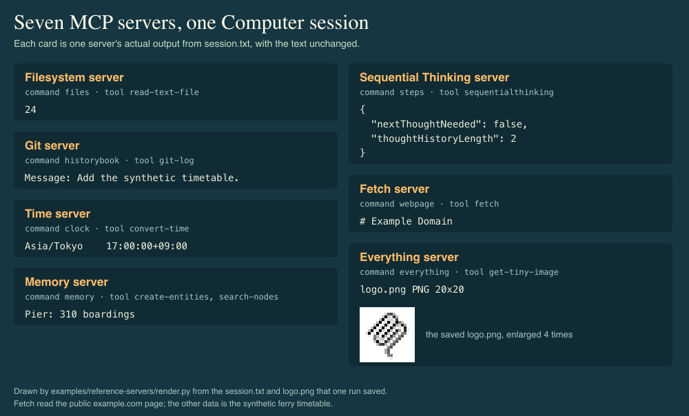

# Seven servers, one shell



Computer starts seven local processes over stdio. A single shell script calls a tool on each one, pipes structured results through jq, stores an image response, and inspects the saved file. The Git repository and memory graph are temporary. Fetch reads the public example.com page.

| MCP server | What the script does |
| --- | --- |
| Filesystem | Counts departures in the JSON timetable served from a read-only directory. |
| Git | Reads the commit message from a new fixture repository. |
| Time | Converts 08:00 UTC to Tokyo time. |
| Memory | Stores a route observation and retrieves it by name. |
| Sequential Thinking | Records two milestones and reads the resulting count. |
| Fetch | Extracts the title of the public example page. |
| Everything | Saves the returned image as a PNG and measures it inside Computer. |

## Replay

Build the Computer CLI. The launcher requires Git, Python 3, npm and uv on the host. On the first run, npx and uvx download the pinned upstream packages. The Fetch example also needs an internet connection.

```sh
CGO_ENABLED=0 go build -o ./bin/computer ./cmd/computer
python3 examples/reference-servers/run.py --computer ./bin/computer --output ./bin/reference-results
```

To reuse installed servers, append `--node-bin` and `--python-bin` followed by the directories containing their executables. The host compares the captured session with the expected transcript. Choose a fresh output directory. The Git server receives the actual path to its temporary fixture. Fetch contacts example.com, and the package managers resolve transitive dependencies during installation.

[Read the shell session](session.sh) · [Inspect the actual output](media/session.txt) · [Upstream reference servers](https://github.com/modelcontextprotocol/servers)

Rebuild the picture on the host from the saved transcript and the actual binary image response. This needs librsvg.

```sh
python3 examples/reference-servers/render.py --report ./bin/reference-results --output ./bin/seven-servers.png
```
