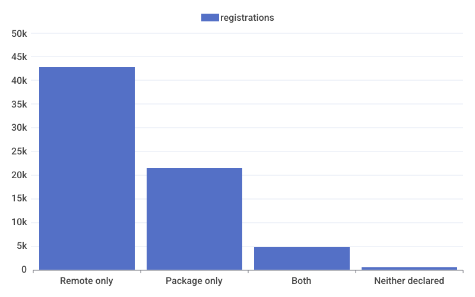

# Take a census of the MCP registry

[](sample/result.json)

How many registrations offer a remote server that a client could configure? On November 22, 2026, Computer followed every cursor in the official registry’s latest-version view. The 703 pages held 70,222 registrations. Of these, 42,878 declared only remote endpoints, 21,665 declared only packages, 4,974 declared both and 705 declared neither. A registration can declare multiple endpoints or packages.

The captured run used guest curl and jq to fetch and inspect the pages, then WASI Python and SQLite to index them. A host-side scan agreed on the counts and SQLite reported a healthy database. The compact capture here contains a count for each category and the SHA-256 digest of each original response. A guest awk program totals the pages and Computer draws the chart. The host independently verifies the chart input and image dimensions.

## Replay the capture

Build Computer from this checkout. Choose a new output directory for each replay.

```sh
CGO_ENABLED=0 go build -o ./bin/computer ./cmd/computer
python3 examples/registry-census/replay.py --computer ./bin/computer \
  --output ./bin/registry-capture
```

The default replay uses the 703 captured count rows and needs no network. The output includes the chart, its CSV and a JSON summary. [Captured page counts and response hashes](sample/page-counts.csv) · [Recorded result](sample/result.json)

## Count live pages

```sh
python3 examples/registry-census/replay.py --computer ./bin/computer \
  --live-pages 2 --output ./bin/registry-live-sample
```

The live mode contacts the official registry metadata route through Computer’s URL allowlist. The guest groups every record with jq. The host verifies each returned page and its four counts. A bounded sample reports whether it reached the final cursor. Use `--live-all` to follow the entire view with a pause between pages. Pagination takes time and the registry can change during a run.

This measures provider declarations. The catalog records actual hosted tool calls separately. Pricing, credentials and service availability require their own checks. [Official registry](https://registry.modelcontextprotocol.io/) · [Hosted-call evidence in the field guide](../offline-guide/catalog.md)
