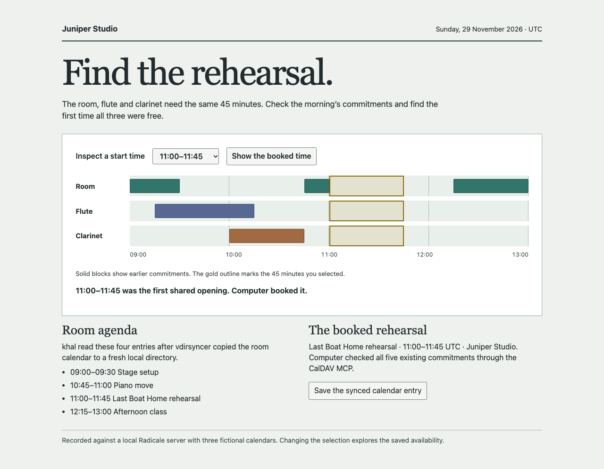

# Find a shared rehearsal slot

[Open the offline studio board](sample/studio.html), choose a start time and see whose earlier commitment overlaps it. The flute, clarinet and Juniper Studio first share 45 minutes at **11:00–11:45 UTC on Sunday, November 29**. Computer books that time and a separate calendar client picks it up. [Watch the browser](sample/studio.webm) · [Download the actual synced calendar entry](sample/rehearsal.ics)



The host starts an isolated Radicale server on loopback with three fictional calendars and five existing events. Computer loads the upstream CalDAV MCP over stdio. Its WASI Python asks for availability, checks quarter-hour start times in chronological order and creates one event on the room calendar. In the recorded run, Radicale answered the free-busy query itself. The generated Python binding calls the CalDAV parameter `from` by the name `x_from`.

Two other readers check the result. A CalDAV REPORT and the icalendar library find the single new event and all five original events. vdirsyncer downloads the actual room to a fresh directory. The khal terminal calendar reads four room entries, including the new rehearsal. The offline board contains that agenda and offers the exact synced ICS bytes for download. The synthetic booking is local to the replay. Visiting the board explores the recorded run.

[Free-busy answer](sample/availability.json) · [Computer booking](sample/booking.json) · [Independent calendars](sample/calendar-check.json) · [khal agenda](sample/agenda.txt) · [Browser checks](sample/browser.json)

## Replay it

Use Node 24 or later and Python 3.12 or later. Build Computer and obtain the project’s WASI Python distribution as described in the repository README. From the repository root, run the following with a fresh output path.

```sh
mkdir -p bin
go build -o bin/computer ./cmd/computer
uv venv bin/calendar-python
uv pip install --python bin/calendar-python/bin/python radicale==3.9.2 icalendar==7.3.2 vdirsyncer==0.20.0 khal==0.14.1
npm install --prefix bin/calendar-node --ignore-scripts @ni-c/caldav-mcp@0.2.0
bin/calendar-python/bin/python examples/rehearsal-calendar/recipe/replay.py \
  --computer bin/computer --python-dir bin/python-wasi-2 \
  --radicale bin/calendar-python/bin/radicale --adapter bin/calendar-node/node_modules/.bin/caldav-mcp \
  --vdirsyncer bin/calendar-python/bin/vdirsyncer --khal bin/calendar-python/bin/khal --out bin/calendar-capture
python3 examples/rehearsal-calendar/build_reader.py bin/calendar-capture
```

Open `bin/calendar-capture/studio.html`. Each run creates new event identifiers and a temporary authenticated calendar that is removed on exit. The weekly schedule and expected shared opening stay fixed. The browser recorder takes the capture directory and a new output directory as arguments. It needs Playwright Core and its FFmpeg helper, with Google Chrome installed.

The open-source adapter implements the calendar tools. Radicale stores the events, vdirsyncer synchronizes them and khal displays the final local schedule. [CalDAV MCP](https://github.com/ni-c/caldav-mcp) · [Radicale](https://github.com/Kozea/Radicale) · [vdirsyncer](https://github.com/pimutils/vdirsyncer) · [khal](https://github.com/pimutils/khal)
