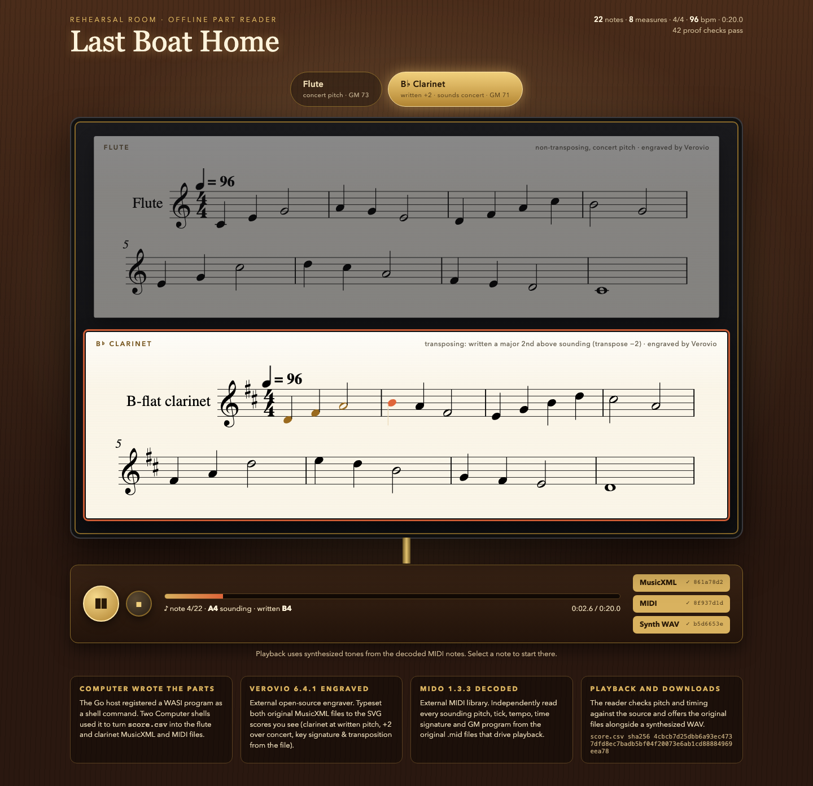

# Last Boat Home, a rehearsal for two instruments

[Open the rehearsal stand](sample/stand.html), choose the flute or B-flat clarinet, then select a note or press Play. Both performers sound the same 22-note melody. The clarinet part is written two semitones higher, so its first printed D sounds as concert C.



The [score](source/score.csv) is an original eight-measure study in 4/4. The Go compiler builds a small WASI program. A [Go host](host/main.go) compiles that bytecode once with Computer’s WASI runtime, registers it as the shell command `part`, and starts two shell sessions on the same Computer. Both read the same read-only score mount. Shell redirection saves each program’s MusicXML and MIDI output to the parts mount.

Each file is ready to take into another reader. Download the flute [MusicXML](sample/flute.musicxml) and [MIDI](sample/flute.mid), or the clarinet [MusicXML](sample/clarinet.musicxml) and [MIDI](sample/clarinet.mid).

## Musical checks

Verovio 6.4.1 engraved the original MusicXML at desktop and phone widths. Mido 1.3.3 decoded the Standard MIDI Files. The comparison checked each onset, duration, concert pitch, written pitch, instrument program and the 96 BPM tempo. Apple's AudioToolbox independently read both files and recovered all 22 notes at the expected positions. Both parts last 20 seconds. The browser uses synthesized tones to audition them.

The [42 score checks](sample/proof.json), [Apple MIDI readback](sample/apple-midi.json) and [64 browser checks](sample/browser.json) accompany the [phone capture](sample/phone.png) and [17.6-second film](sample/rehearsal.mp4). The film uses the actual browser recording with the synthesized WAVs mixed at the recorded play times. Audio playback, selection, seeking and downloads were also checked in the running page.

## Replay

Run these commands from the repository root using a fresh output directory. The WASI command is built from source and needs no additional runtime distribution.

```sh
mkdir -p bin
GOOS=wasip1 GOARCH=wasm CGO_ENABLED=0 go build -trimpath -o bin/part.wasm ./examples/rehearsal-room/guest
go run ./examples/rehearsal-room/host bin/part.wasm examples/rehearsal-room/source bin/rehearsal
uv run --with verovio==6.4.1 --with mido==1.3.3 python examples/rehearsal-room/reader/build_reader.py \
  --parts bin/rehearsal/parts --source examples/rehearsal-room/source/score.csv \
  --computer-json bin/rehearsal/computer.json --out bin/rehearsal/reader
```

The portable reader is `bin/rehearsal/reader/index.html`. On macOS, run `swift examples/rehearsal-room/reader/NativeMidi.swift examples/rehearsal-room/source/score.csv bin/rehearsal/parts` for the independent native check. With Playwright 1.65.2 and its Chromium installed, run `reader/verify_browser.py --site <reader> --parts <parts> --out <new-evidence-directory>` from this example directory. Use Python to launch the script. The companion `reader/make_film.py` accepts `--site` and `--out` and uses FFmpeg.

The notation follows the MusicXML written-to-sounding transposition convention. The verifier reads the two original MusicXML documents and renders their engraved notes and timing maps. [MusicXML 4.0 transposition](https://www.w3.org/2021/06/musicxml40/musicxml-reference/elements/transpose/) · [Verovio toolkit methods](https://book.verovio.org/toolkit-reference/toolkit-methods.html)
