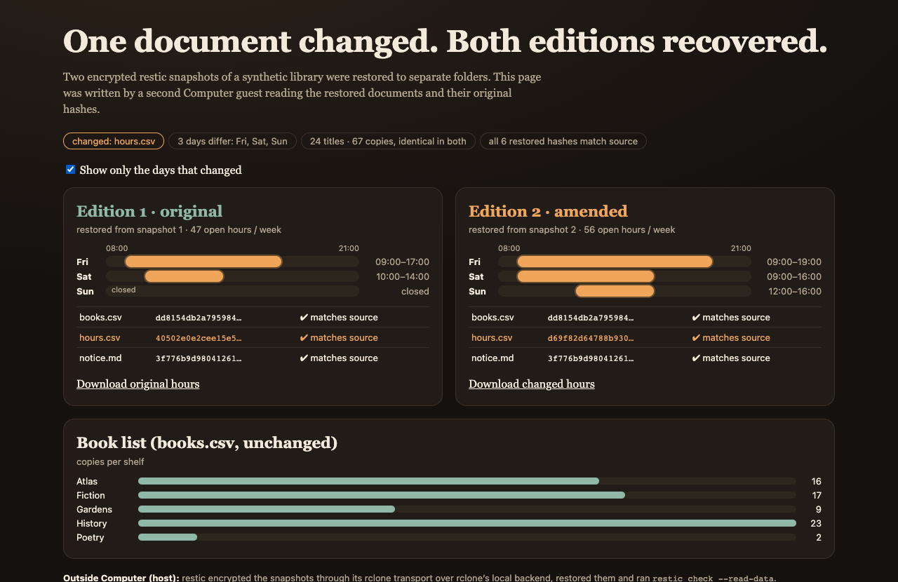

# Recover two editions of a reading room’s opening hours

[Compare the restored editions](sample/library.html). Show just the days that changed, or download either set of opening hours. Friday, Saturday and Sunday gained nine hours in total, taking the reading room from 47 to 56 hours per week. Its 24 titles and 67 copies were identical in both snapshots.



Computer used WASI Python to write a synthetic catalog, a notice and the original hours. A second guest invocation amended the schedule. The host backed up both editions with restic’s encrypted repository format through rclone’s stdio transport and a local backend. It restored each snapshot to its own directory and ran a full repository data check. A fresh Computer process mounted both restored trees and the source hashes read-only. A separate writable report directory received the offline comparison page.

The [snapshot receipt](sample/receipt.json) records the tool versions, two different snapshot IDs, the file reported by restic’s diff and the completed checks. The [guest comparison](sample/comparison.json) includes the six restored file hashes. The host independently matched the same bytes against both original trees. The [browser capture](sample/library.webm), [phone view](sample/phone.png) and [download receipts](sample/browser.json) document both exports.

## Replay

Install restic and rclone locally. This run used restic 0.20.0 and rclone 1.74.3. Build Computer and supply its WASI Python runtime as described in the [project README](../../README.md).

```sh
python3 examples/restored-library/replay.py \
  --computer ./bin/computer --python-dir ./bin/python-wasi-2 \
  --output ./bin/restored-library
```

You may pass explicit binary paths with `--restic` and `--rclone`. Each replay uses an empty temporary home, a new configuration with rclone's local backend and a fresh random repository password. The script discards the temporary encrypted repository after verifying both restores. Your new output directory retains both restored document trees, the report and the receipt. The two backup timestamps are fixed examples to make the edition order easy to inspect. The actual snapshot IDs differ on every run.

With Chrome and Playwright Core available, run `node examples/restored-library/record.cjs ./bin/restored-library ./bin/restored-library-capture` to check both viewports and compare each downloaded CSV with its restored source. The entire demo runs locally.
