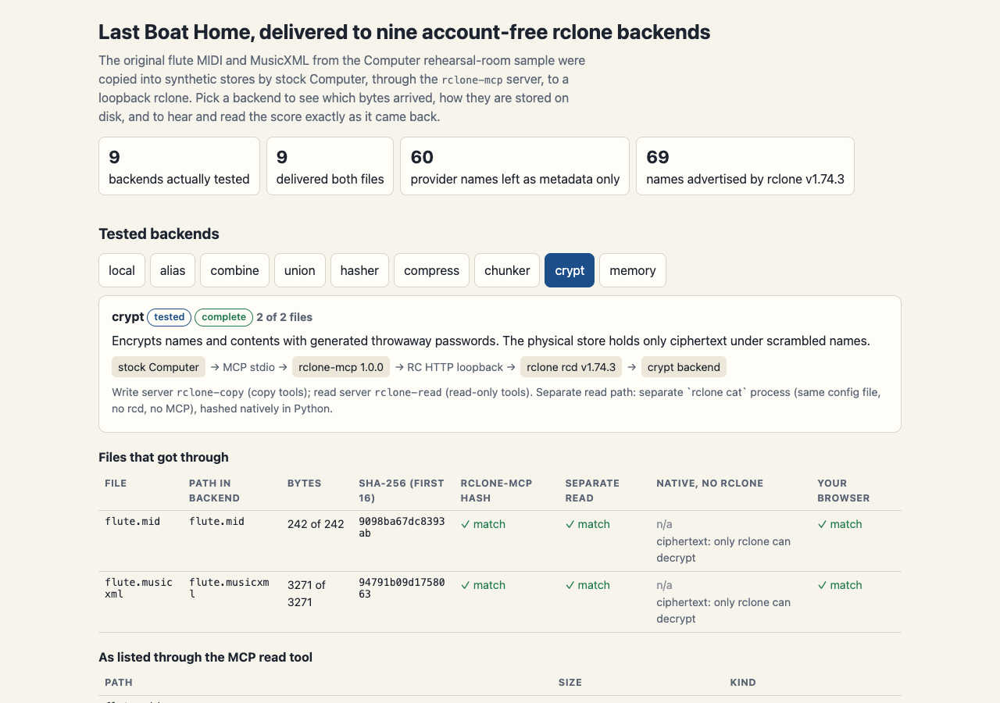

# Deliver a musical score to nine rclone stores

[Open the offline score library](sample/index.html) · [See all nine deliveries](sample/evidence.json) · [Inspect the browser checks](sample/capture-log.txt)



Computer ran two instances of the free rclone MCP server. One copied a 242-byte flute MIDI and its 3,271-byte MusicXML part into a selected rclone backend. A separate read-only instance listed the results and hashed the retrieved files. Each of the 18 deliveries matched the pinned score. The reader opens without a network connection, lets you choose a store and plays the score retrieved from it.

| Store | What the replay observed |
| --- | --- |
| Local, alias, hasher | The physical files contained the original bytes. |
| Combine | The files landed under two different physical directories. |
| Union | The two score files landed on the writable member, beside a view of another member’s seeded note. |
| Compress | A native gzip reader independently recovered the two files. |
| Chunker | The XML occupied four chunks plus metadata. Concatenating the parts recovered its original bytes. |
| Crypt | The backing store held encrypted names and contents. A separate rclone process recovered both originals. |
| Memory | The running RC server served both objects. The same remote in a separate process was empty. |

For disk-backed stores a separate `rclone cat` retrieved each file. For memory a separate HTTP reader retrieved the objects from the same running RC server. Seven backends also admitted a native reconstruction without rclone. The directory lists 69 provider types reported by rclone 1.74.3. Nine were exercised in this replay. The other 60 are described from local configuration metadata.

## Replay

Use rclone, Node.js with npm, Go and a built Computer. The captured stock build was `ea7bf2356c679b2b2ebddf0498be4616da22ec83`. The MCP adapter is pinned to npm package `rclone-mcp@1.0.0` with the two generated rclone API packages at 1.74.2. The script installs the lockfile, prepares synthetic directories and starts its own password-protected loopback RC server. The writable adapter exposes more operations than this recipe uses. Its only write operation in this example is copying the two score files.

```sh
python3 -I examples/score-stores/scripts/run-lab.py --computer ./bin/computer \
  --source examples/rehearsal-room/sample --lab ./bin/score-lab --out ./bin/score-receipts
python3 -I examples/score-stores/scripts/build-public.py --computer ./bin/computer \
  --evidence ./bin/score-receipts --stage ./bin/score-reader
```

Choose fresh directories. The copies go to the generated local remotes. Source data and composition are available in the [original score example](../rehearsal-room/README.md). The stripped-down native verification for encrypted and in-memory files is visible in each backend’s receipt. [rclone MCP source](https://github.com/rclone-ui/rclone-mcp)
