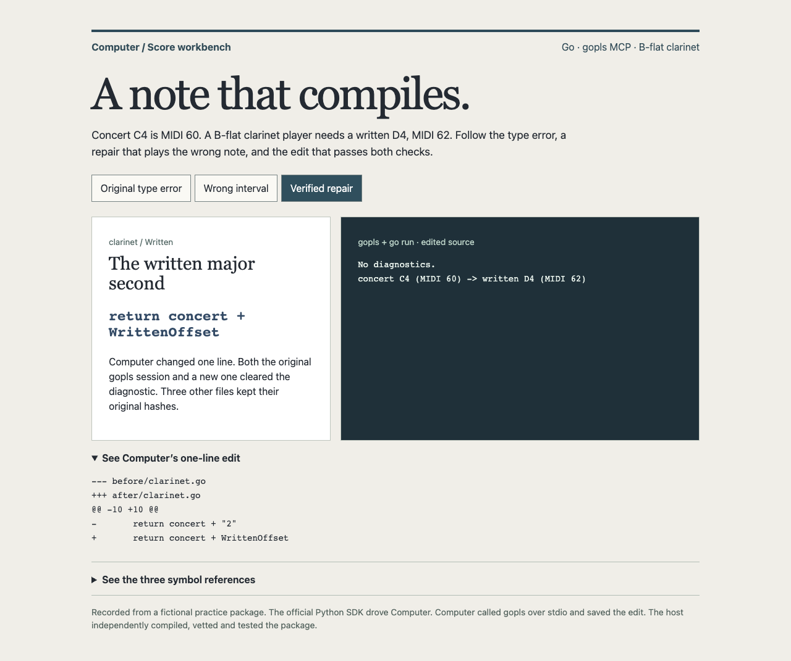

# Repair a clarinet part with Go’s language server

[Try the offline workbench](sample/workbench.html) · [Watch the three comparisons](sample/workbench.webm) · [Read the actual one-line edit](sample/repair.diff)



The practice package converts a concert pitch to a written B-flat clarinet pitch. A string in the arithmetic initially prevents it from compiling. The official Python MCP client starts Computer with the official gopls stdio server upstream. Inside Computer, the shell requests workspace information, diagnostics, symbol search, references and the package API. gopls finds three references to the affected function. The outer Computer `edit` tool changes one line and saves the file.

The original gopls session and a second fresh session both report a clean diagnostic. The host runs Go build, vet, test and the example program. Concert C4 (MIDI 60) becomes written D4 (MIDI 62). A separate control compiles with the wrong interval of three semitones, and the musical tests catch written MIDI 63. The [receipt](sample/receipt.json) contains the compiler result, diagnostics, symbol references, diff, unchanged filenames and control failure.

## Replay

Install Go, gopls and the official Python MCP SDK. The recorded language server was gopls v0.23.0. From the repository root, choose a fresh output directory.

```sh
mkdir -p bin
go build -o bin/computer ./cmd/computer
uv run --with mcp python examples/score-workbench/replay.py --computer bin/computer --output bin/score-workbench
python3 examples/score-workbench/build_reader.py bin/score-workbench
```

The runner gives gopls and Computer access to one newly copied practice module. It sets Go’s module proxy and telemetry off and supplies an empty temporary home and compiler cache. A scripted client selects the tool calls. The browser page presents three recorded outcomes, including the case where successful compilation still produces the wrong note. [gopls MCP documentation](https://go.dev/gopls/features/mcp)
