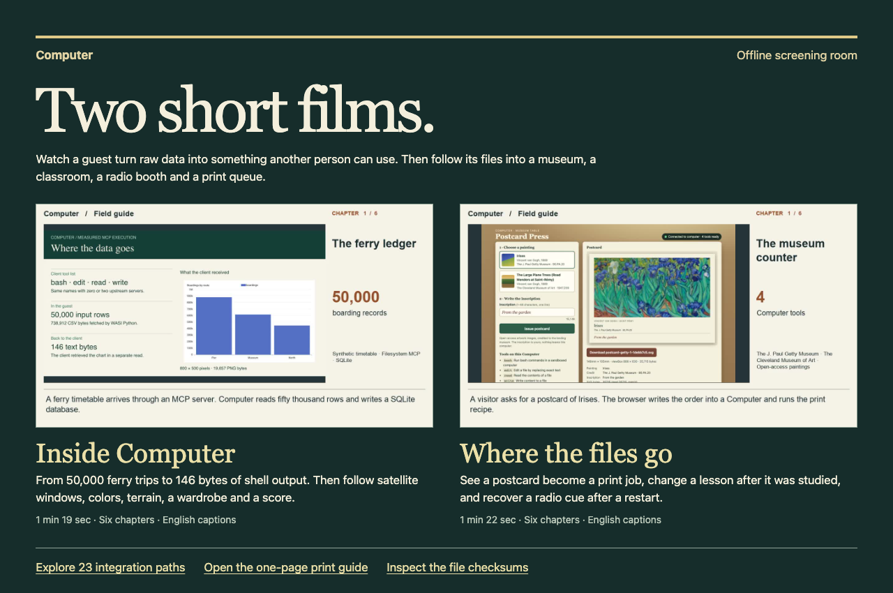

# A screening kit you can carry offline

[](sample/computer-screening-kit.zip?raw=true)

[Download the screening kit](sample/computer-screening-kit.zip?raw=true). Unzip it and open **index.html**. The kit contains the two narrated films, twelve chapter positions, English captions and transcripts, a one-page printable field guide and the interactive map of 23 integration paths. All work offline. The print guide also contains links to the original public exhibits.

Computer made the ZIP. The WASI Python guest read the 15 originals from one read-only mount, generated a checksum manifest, and wrote the 16-member archive into its output mount. Two stock Computer invocations produced identical 6,077,052-byte archives. A host-side ZIP reader compared all 15 original entries byte for byte. On desktop and phone, offline Chrome decoded the posters, opened the integration map and played the final chapter of each film. [Packaging receipt](sample/receipt.json) · [Browser checks](sample/browser.json)

## Rebuild

From the repository root, supply the stock Computer executable and its WASI Python release. Choose a new output directory.

```sh
python3 examples/screening-kit/replay.py --computer ./bin/computer \
  --python-dir ./bin/python-wasi-2 --output ./bin/screening-kit
```

The two [original](../field-film/) [films](../field-film/working-files/) describe the synthetic narration, original footage and source licenses. The [map](../integration-map/) identifies which operations ran in Computer. The [print guide](../pocket-guide/) includes its original six images and links.
