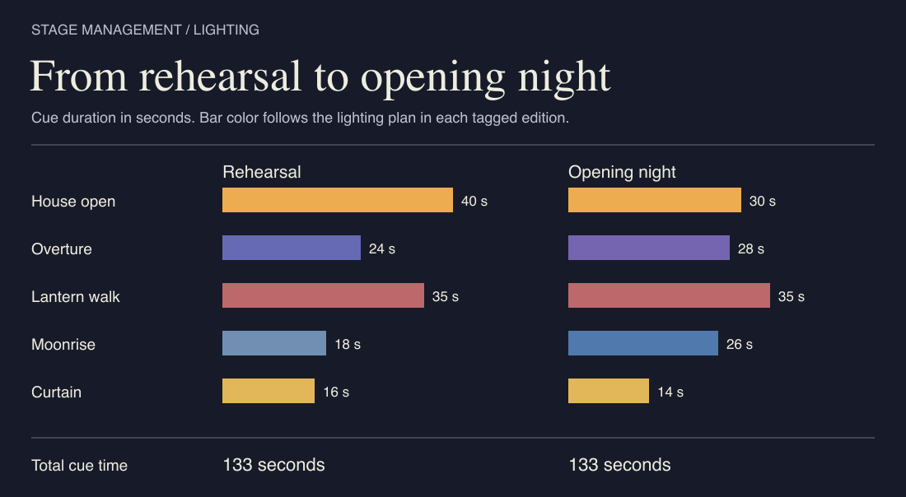

# Compare two editions of a stage lighting plan



Both editions of this synthetic show run for **133 seconds**. Four of its five cues changed duration and two changed color. A stage manager needs the differences before the next rehearsal.

A Go host gives Computer two read-only mounts, one for each Git tag. The shell reads each tag’s `cues.csv`, joins the cues by name and draws the SVG with awk. The host uses go-fsimpl’s Git filesystem, which clones the local repository into memory on first access and reads the selected revision. A small adapter translates rooted mount paths to relative `io/fs` paths. The two tags continue to present their own trees after a stagehand overwrites the working copy.

| Cue | Rehearsal | Opening |
| --- | ---: | ---: |
| House open | 40 s | 30 s |
| Overture | 24 s | 28 s |
| Lantern walk | 35 s | 35 s |
| Moonrise | 18 s | 26 s |
| Curtain | 16 s | 14 s |

## Replay

From the repository root, build the separate example module, then run the Python 3.10+ replay in a new output directory. It creates a temporary local Git repository with two deterministic tags. The host needs Go and Git. The Go module dependencies download on first build.

```sh
mkdir -p ./bin
CGO_ENABLED=0 go -C examples/stage-lighting build -o ../../bin/stage-lighting .
python3 examples/stage-lighting/replay.py --host ./bin/stage-lighting --output ./bin/lighting-report
```

Open `bin/lighting-report/cues.svg` in a browser. The replay independently reads both tagged files with `git show`, compares all the joined rows, verifies the color and width of the ten SVG bars and checks that the uncommitted working file is untouched. To reproduce the PNG preview on a machine with librsvg, run the following command.

```sh
rsvg-convert ./bin/lighting-report/cues.svg -o ./bin/lighting-report/cues.png
```

[Guest-generated SVG](sample/cues.svg) · [Joined cue data](sample/comparison.csv) · [Recorded checks and Git hashes](sample/checks.json) · [Go mount wiring](main.go) · [SVG drawing program](cue-sheet.awk) · [Git filesystem adapter](https://pkg.go.dev/github.com/hairyhenderson/go-fsimpl/gitfs)
