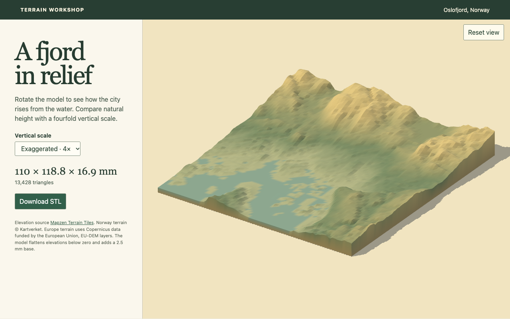
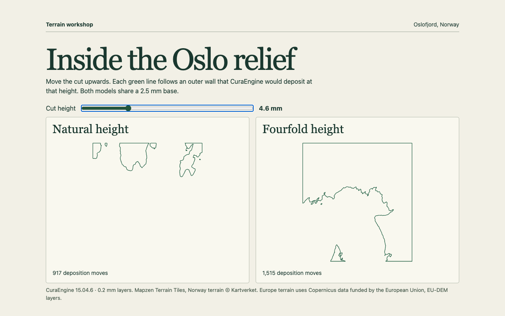

# Explore the Oslofjord in relief

Download the workshop, unzip it and open **model.html**. Drag to rotate the Oslofjord, compare the two vertical scales, or save either original STL. Open **layers.html** and move the cut to 8.0 mm. Only the fourfold relief still has outer walls at that height. Both pages work offline. The 3D view requires WebGL 2. [Download the workshop](sample/workshop.zip) · [Watch the rotation and layer reader](sample/rotate.webm) · [Phone view](sample/phone.png)

[](sample/workshop.zip)

## What Computer does

The stock CLI mounts a 22 KB elevation grid read-only. WASI Python writes two closed binary STL solids, each with 13,428 triangular faces. With the optional viewer bundle, the guest packages the original STL bytes into the Three.js reader. The live replay fetches the pinned 7 MB Mapzen tile through one allowed URL and extracts the same 6,399 samples inside Computer. The captured and live runs produced identical solids.

CuraEngine 15.04.6 runs on the host. It slices the two solids with 0.2 mm layers. Computer reads its G-code and publishes a second offline reader with the actual outer-wall paths at each height. The final numbered layer in both slicer files contains shutdown movements and has zero deposition moves. All measurements below come from software. No model was physically printed.

| Measurement | Natural height | Fourfold height |
| --- | ---: | ---: |
| Footprint | 110.0 × 118.8 mm | 110.0 × 118.8 mm |
| Overall model height | 6.1 mm | 16.9 mm |
| Layers with deposition | 30 | 84 |
| Highest deposition | 6.0 mm | 16.8 mm |
| Deposition moves | 23,539 | 83,186 |

[](sample/workshop.zip)

An independent binary STL reader counted 20,142 edges with exactly two oppositely oriented faces per edge, one connected component and a positive signed volume in each solid. ADMesh 0.98.5 reported zero disconnected or degenerate facets in both. Chrome rotated and reset the models, verified exact download bytes at desktop and phone widths, and moved through the slice reader by keyboard. [Topology measurements](sample/checked.json) · [Native slice counts](sample/layers.json) · [Browser receipts](sample/browser.json)

## Reproduce the two solids

From the repository root, build the stock CLI and prepare the WASI Python distribution as described in the main README. Run the replay with a new output directory.

```sh
python3 examples/terrain-workshop/replay.py --computer ./bin/computer \
  --python-dir ./bin/python-wasi-2 --output ./bin/fjord
```

Add `--live` to fetch, verify and resample the source tile. To generate the layer reader, also pass `--cura /path/to/CuraEngine` using the pinned release. On arm64 macOS the upstream Makefile's 2015 Darwin flags target obsolete CPUs. A fresh build with `make UNAME=Native VERSION=15.04.6` used the native compiler and its normal flags. [CuraEngine source](https://github.com/Ultimaker/CuraEngine/tree/aca2c17ebaf5722137568bc8aeadd2be001a7a34)

To rebuild the 3D reader, copy [viewer.js](reader/viewer.js) into an empty working directory and run the following there. Supply the resulting file to the replay using `--viewer-bundle /path/to/viewer.bundle.js`.

```sh
npm install --no-save three@0.182.0 esbuild@0.28.2
./node_modules/.bin/esbuild viewer.js --bundle --format=iife --minify --legal-comments=inline --outfile=viewer.bundle.js
```

To repeat the recording, install Playwright Core and its FFmpeg helper with Google Chrome available. Run `NODE_PATH=/path/to/node_modules node examples/terrain-workshop/record.cjs ./bin/fjord` after generating both pages.

The source bounds are 10.57–10.86° E and 59.84–59.997° N. The model uses 81 × 79 nearest-neighbor samples, a local equirectangular distance approximation and a 2.5 mm base. Elevations below sea level are flattened. This teaching model represents a sampled landscape. Mapzen Terrain Tiles supply the elevation data. Norway terrain © Kartverket. Europe terrain uses Copernicus data funded by the European Union, EU-DEM layers. [Original tile and digests](recipe/source.json) · [Terrain dataset](https://registry.opendata.aws/terrain-tiles/)
