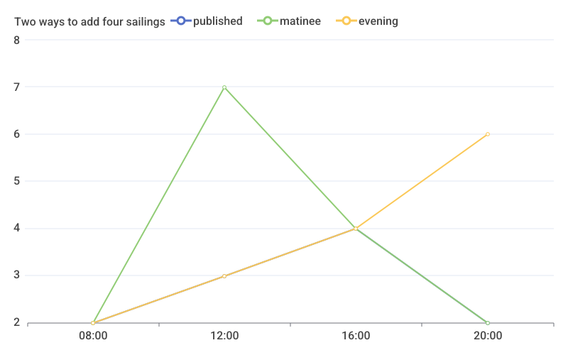

# Try two timetables on the same files



There is room for four extra ferry sailings. One dispatcher puts them at noon. Another puts them in the evening. Each edits the same filename in their own Computer.

The Go host seeds one read-only in-memory filesystem with the published timetable. It supplies that base and a fresh writable memory layer to each Computer using an afero copy-on-write filesystem. Computer's `Environment.Write` changes each draft, and its shell reads that change and totals the sailings. After both edits the host reads all three workspaces again. Their schedules still differ at the intended times.

| Workspace | Noon | Evening | Daily total |
| --- | ---: | ---: | ---: |
| Published | 3 | 2 | 11 |
| Matinee | 7 | 2 | 15 |
| Evening | 3 | 6 | 15 |

The host exports those exact files to a fresh directory. A fourth Computer mounts the directory, joins the schedules by their common row order and draws the comparison. The application chooses the storage layout. Computer gives the shell and the Go environment the same view of each mount.

## Replay

From the repository root, run this Go example with a new output directory. The Go module dependencies are the only downloads required.

```sh
go run ./examples/what-if-workspaces -output ./bin/timetable-plans
```

[Read the host program](main.go) · [Inspect the input](schedule.csv) · [Inspect the joined schedules](sample/comparison.csv)
